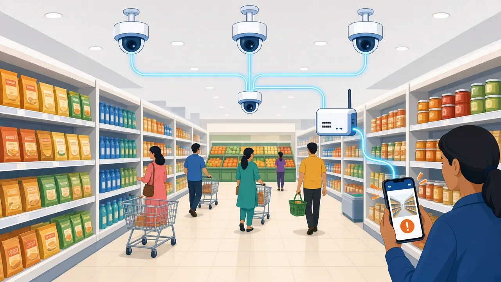
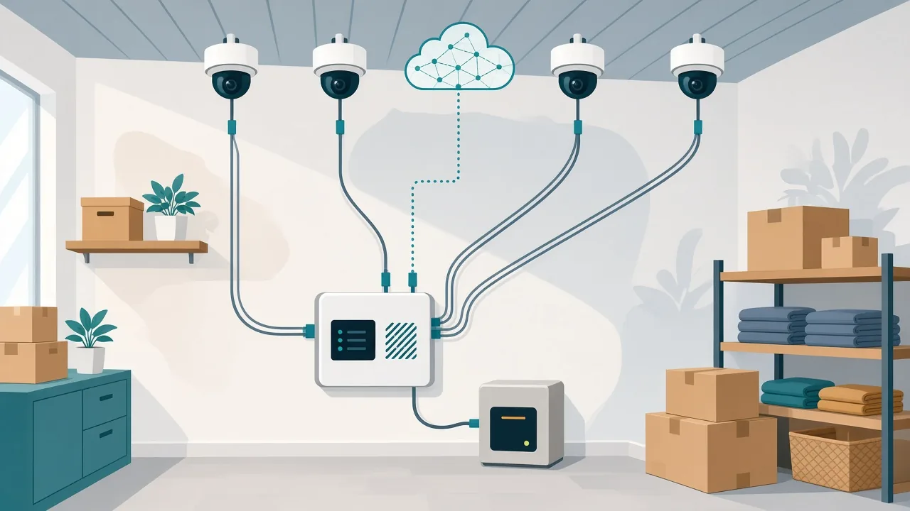
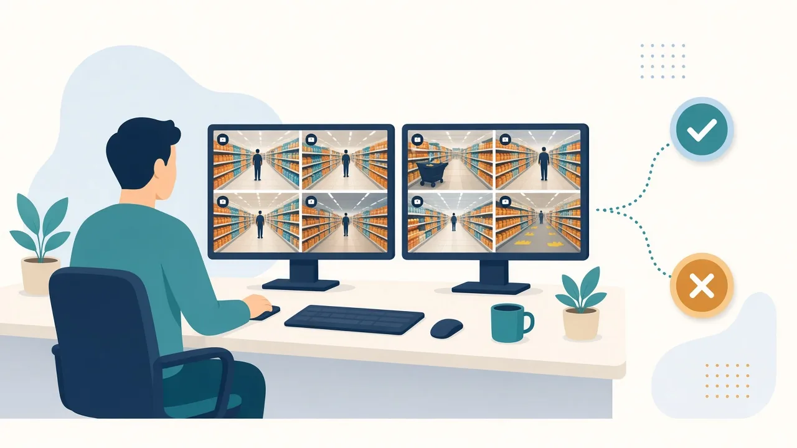

Full interactive version: [Open the Page](https://cursor.com/canvas/store-a14936a9-4c92-418f-9740-2e7facf80af6/cb74e521-df34-423b-99ce-d3f175e23711)

> [!NOTE]
> Prepared 31 Oct 2026. Currency: INR and USD at about ₹95 per USD. Anything marked **(Estimate)** or **(Judgement)** is my own working assumption, not a sourced fact. Not legal advice. Hardware prices were checked in Oct 2026 and Jetson prices have been unusually volatile.



*Illustration (generated, not a photograph).*

## 0. The idea in one paragraph

Build a camera-based "loss intelligence" layer that sits on top of cameras a store already owns. It watches for **behaviour** (concealment gestures, bypassing the scanner, return abuse, gathering and repeat patterns), not identity, and sends a short clip to a human (staff member, then remote reviewer) who decides what to do. The key product decisions are where the AI runs (store edge, central cloud, or both), how alerts become *safe, lawful, proportionate* action, and where the economics work in India, where reported shrink is much lower than in the US/EU.

**Headline findings**

- **Edge-first hybrid wins on cost, privacy and offline resilience.** For a 16-camera store, streaming everything to a cloud GPU is roughly 6x (best case) to 15x (mid case) more expensive over 36 months than a single edge box (Estimate, section 3.4).
- **India's economics are the hard part.** Reported Indian shrink is about 0.2 to 0.5% for several listed chains, so a per-camera SaaS price only pays back for large-revenue stores or high-shrink categories (section 9). Bundle theft with operations analytics.
- **External theft is only about a quarter of retail loss** (IHL/Sensormatic 2026), so the product should also cover POS fraud, returns, employee theft and receiving, not just shoplifting.
- **The biggest legal risk is biometric/face matching and wrongful accusation**, not the cameras themselves. Default to no face recognition, always keep a human in the loop.

---

## 1. Concept and problem size

### 1.1 Global and US numbers

| Metric | Figure | Source / note |
|---|---|---|
| Global shrink, 2018 | 1.82% of retail sales, about $99.56B; survey of 1,120 retailers in 14 countries | [Sensormatic Global Shrink Index 2018](https://ram.memberclicks.net/assets/docs/Sensormatic-Global-Shrink-Index.pdf) and [Inside Retail Asia](https://insideretail.asia/2018/08/08/global-shrinkage-cost-retailers-nearly-100-billion-last-year-says-tyco/) (old, but the last comparable global index) |
| US shrink, FY2022 | 1.6% of sales, $112.1B; theft about 65% of shrink (external 36%, employee 29%, process failures 27%) | [NRF press release](https://nrf.com/media-center/press-releases/shrink-accounted-over-112-billion-industry-losses-2022-according-nrf) and [NRF survey page](https://nrf.com/research/national-retail-security-survey-2023). NRF did not publish a later shrink rate in the sources I found, so this is dated. |
| External theft share of loss, 2026 | About 25% of total retail loss (the other 75%: supply chain, returns, e-commerce fulfilment, admin failures); 1,421 retailers in 12 countries | [Beyond Shrink 2026, IHL Group with Sensormatic](https://www.ihlservices.com/news/analyst-corner/2026/10/beyond-shrink-2026-total-retail-loss-ondemand/) and [Sensormatic press release](https://www.sensormatic.com/resources/pr/2026/beyond-shrink-report-press-release) |
| Retailers reporting increases (IHL 2026) | Shoplifting 69%, return fraud 68%, ORC 65%, employee theft 64%, supplier fraud 55%, sweethearting 54% | [IHL research findings](https://www.ihlservices.com/news/ihl-research-findings/) |
| Avg cost of an employee-theft incident | About $107 | [IHL research findings](https://www.ihlservices.com/news/ihl-research-findings/) |
| Loss-prevention spend | About 1.2% of sales, 27% of it on technology | [IHL research findings](https://www.ihlservices.com/news/ihl-research-findings/) |
| US trend 2025 vs 2024 | NRF 2026 survey (66 companies): shoplifting incidents -12.4%, merchandise theft -8.1%; NRF credits security technology, training, store hardening and loss-pattern analysis | [NRF press release](https://nrf.com/media-center/press-releases/retailers-see-fraud-schemes-evolve-as-shoplifting-declines-nrf-study-finds) |
| Self-checkout | Stores with self-checkout had about 33% higher losses; losses rose about 22% in the first year after installation (39 retailers) | [University of Leicester](https://le.ac.uk/news/2026/june/retail-loss-self-checkout), [ECR Retail Loss](https://ecrloss.com/research-paper/self-checkout-loss-report-2026/), [The Grocer](https://www.thegrocer.co.uk/news/self-checkouts-increase-store-losses-by-22-in-first-year-major-study-finds/720246.article) |

```viz
{
"type": "bar",
"title": "Retailers reporting an increase in each loss type (IHL 2026)",
"note": "Share of surveyed retailers that report an increase. Retailer-reported perception, not measured loss.",
"max": 100,
"items": [{"label": "Shoplifting", "value": 69, "display": "69%"}, {"label": "Return fraud", "value": 68, "display": "68%"}, {"label": "Organised retail crime", "value": 65, "display": "65%"}, {"label": "Employee theft", "value": 64, "display": "64%"}, {"label": "Supplier fraud", "value": 55, "display": "55%"}, {"label": "Sweethearting", "value": 54, "display": "54%"}]
}
```

**Reading between the lines (Judgement):** US shoplifting incident counts are no longer rising, while return fraud, internal theft and fraud at POS are growing in retailers' perception. A pure "catch shoplifters" product addresses only about a quarter of loss. A broader "retail loss intelligence" product is the stronger business.

> [!NOTE]
> Treat headline organised-retail-crime statistics with care and prefer retailer-measured data from a pilot. Survey figures above are retailer-reported and definitions differ between studies.

### 1.2 India

| Data point | Figure | Source |
|---|---|---|
| India shrink, 2018 | 2.13% of sales (second highest of 14 countries), about $0.52B loss | [Sensormatic Global Shrink Index 2018](https://ram.memberclicks.net/assets/docs/Sensormatic-Global-Shrink-Index.pdf) |
| Retailers Association of India view | Shrinkage up to 0.5% is "manageable" vs 1.5 to 2% global average (RAI CEO) | [Economic Times](https://economictimes.indiatimes.com/industry/services/retail/stop-thief-retail-in-a-spot-as-customers-go-big-on-stocktaking/articleshow/111006169.cms) |
| Listed chains (reported, FY24) | Trent 0.41% (up from 0.22%), V-Mart 0.5% (from 0.4%), Woodland about 0.2% | [Economic Times](https://economictimes.indiatimes.com/industry/services/retail/stop-thief-retail-in-a-spot-as-customers-go-big-on-stocktaking/articleshow/111006169.cms), [Business Standard](https://www.business-standard.com/industry/news/shoplifting-employee-theft-indian-retail-firms-see-rise-in-shrinkage-124061500403_1.html) |
| Worst categories (my earlier research, link not re-verified) | Apparel/footwear/fashion and gadgets in Indian press; drugstores/pharmacies topped an APAC vertical ranking at 2.62% in an older index | Treat as indicative only |
| Organised share of Indian retail | About 13%; the rest is mostly kirana stores (number in the millions) | DMart annual report citing CRISIL (link not re-verified) |

```viz
{
"type": "bar",
"title": "Reported shrink as % of sales",
"note": "Orange: Indian listed chains (company-reported, FY24; Woodland is about 0.2%). Violet: survey-based figures from other years and definitions. Not like-for-like.",
"max": 2.5,
"items": [{"label": "Woodland (FY24)", "value": 0.2, "display": "about 0.2%"}, {"label": "Trent (FY24)", "value": 0.41, "display": "0.41%"}, {"label": "V-Mart (FY24)", "value": 0.5, "display": "0.5%"}, {"label": "US (NRF, FY2022)", "value": 1.6, "display": "1.6%", "c": 3}, {"label": "Global (2018)", "value": 1.82, "display": "1.82%", "c": 3}, {"label": "India (2018)", "value": 2.13, "display": "2.13%", "c": 3}]
}
```

**Caveat:** these Indian figures are company-reported or survey-based, use different definitions (book vs physical shrink, with or without admin error and vendor fraud), and are not like-for-like. Treat them as ranges, not benchmarks.

---

## 2. What the AI detects, and how

### 2.1 Behaviours (the "patterns" in stealing patterns)

| Pattern | What the system sees | Signals needed | Difficulty |
|---|---|---|---|
| Concealment (pocket, bag, under clothes, pram) | Hand-to-shelf-to-body motion sequences | Pose + action recognition on person crops, shelf zone | Medium; high false positives from customers adjusting bags |
| Sweethearting at POS | Items passed but not scanned, or cashier "scans" cheaper item | Video fused with POS transaction log | Medium; needs POS integration |
| Self-checkout fraud | Ticket/barcode switching, skip-scanning, produce mislabeled as cheaper | Overhead camera at SCO + item recognition + scan events | Medium to hard |
| Loitering and dwell | Long dwell near high-value shelf, repeated passes, camera-aware behaviour | Tracking + zone dwell time | Easy to detect, low precision alone |
| Gathering / sweep patterns | Many items swept off shelf, group distraction | Object count change on shelf + multi-person tracking | Medium |
| Repeat offenders | Same person across visits and branches | Re-identification (appearance or face) | **Highest legal risk** |
| Organised retail crime (ORC) | Coordinated groups, multi-store, same SKUs | Cross-store analytics, incident database, watchlists | Needs central layer |
| Return fraud | Return of items not bought, switched items | Receiving/returns desk camera + receipt + SKU match | Medium |
| Employee theft | Void/refund abuse, back-door removals, unusual till behaviour | POS exceptions + door/storeroom cameras | Medium; HR/labour-law sensitive |

### 2.2 Model approaches (candidate stack, benchmarks not verified)

| Layer | Candidates | Notes |
|---|---|---|
| Object detection | YOLO family, RT-DETR | **Licence matters:** Ultralytics YOLO is AGPL-3.0 and needs an [enterprise licence](https://www.ultralytics.com/legal/enterprise-software-license) for closed commercial/SaaS use; Baidu RT-DETR is Apache-2.0 ([Roboflow](https://playground.roboflow.com/models/baidu/rt-detr)); weights loaded through the Ultralytics package are AGPL |
| Tracking | ByteTrack, BoT-SORT | Single-camera tracking, cheap on edge |
| Pose and action | RTMPose / YOLO-pose, SlowFast, VideoMAE via MMAction2 | Run on person crops only near shelves/POS to save compute |
| Multi-camera re-ID | OSNet-style appearance re-ID | Appearance-based, not face; still treated as personal data |
| POS-video fusion | Rule engine over POS exceptions + item/hand detection | Highest precision per rupee; start here |
| Anomaly detection | Weakly-supervised video anomaly models | Useful for discovering new patterns; poor precision alone |
| VLM event review | Open or hosted vision-language models on short clips | Second-stage filter on the central side to cut false alerts; **(Judgement)** use as triage not decision |

**Academic caveat (Judgement):** public shoplifting datasets are small, staged and not from Indian store lighting, camera angles or crowd density. Plan to collect and label your own data from day one.

### 2.3 False positives and bias

- A false alert has a human cost: a staff member approaches an innocent customer. Optimise for **alert precision**, then recall.
- Behaviour alerts should be **identity-blind**. Do not infer age, gender, caste, religion, or "suspicious appearance".
- Test performance by lighting, camera angle, clothing (burqa, saree, dupatta, jackets), skin tone, children, wheelchair users. Report failures by subgroup.
- The Rite Aid case (section 6) is the cautionary example of facial matching misfires disproportionately flagging women and people of colour.
- Alert wording to staff should be neutral ("check this aisle"), never "thief".

---

## 3. Architecture options

### 3.0 End-to-end flow (camera to alert to human review to evidence)



```viz
{
"type": "flow",
"title": "End-to-end flow: camera to alert to human review to evidence",
"nodes": [{"id": "cam", "label": "Cameras", "col": 0, "row": 0}, {"id": "edge", "label": "Edge box", "col": 1, "row": 0, "kind": "key", "sub": "detect, track, action model, POS fusion"}, {"id": "d1", "label": "Rule match and confidence above threshold?", "col": 2, "row": 0, "kind": "decision"}, {"id": "dis1", "label": "Dismiss and label", "col": 3, "row": 0, "kind": "muted"}, {"id": "alert", "label": "Neutral alert to staff", "col": 2, "row": 1}, {"id": "review", "label": "Human review", "col": 1, "row": 1}, {"id": "d2", "label": "Confirmed?", "col": 1, "row": 2, "kind": "decision"}, {"id": "low", "label": "Lowest intervention (tiers 0 to 4)", "col": 0, "row": 2}, {"id": "dis2", "label": "Dismiss and label", "col": 2, "row": 2, "kind": "muted"}, {"id": "evid", "label": "Evidence pack", "col": 0, "row": 3}, {"id": "learn", "label": "Central learning", "col": 2, "row": 3, "kind": "good"}],
"edges": [{"from": "cam", "to": "edge"}, {"from": "edge", "to": "d1"}, {"from": "d1", "to": "dis1", "label": "no"}, {"from": "d1", "to": "alert", "label": "yes"}, {"from": "alert", "to": "review"}, {"from": "review", "to": "d2"}, {"from": "d2", "to": "low", "exit": "left", "enter": "right", "label": "yes"}, {"from": "d2", "to": "dis2", "exit": "right", "enter": "left", "label": "no"}, {"from": "low", "to": "evid"}, {"from": "evid", "to": "learn", "exit": "right", "enter": "left"}, {"from": "dis2", "to": "learn"}, {"from": "dis1", "to": "learn", "exit": "bottom", "enter": "right"}]
}
```

### 3.0.1 Data flow compared

```viz
{
"type": "flow",
"title": "Data flow compared, 16 cameras",
"cellW": 250,
"gapX": 30,
"gapY": 44,
"nodes": [{"id": "cams", "label": "16 cameras", "col": 1, "row": 0, "kind": "key"}, {"id": "e", "label": "Edge only: analyse in store, raw video stays local, local alert, works offline", "col": 0, "row": 1, "sub": "about $1,655 over 36 months (Estimate)"}, {"id": "h", "label": "Hybrid: analyse in store, send 5 to 15 s clips and metadata, local alert and central review", "col": 1, "row": 1, "kind": "good", "sub": "about $2,519 over 36 months (Estimate)"}, {"id": "c", "label": "Central: stream everything (38 to 77 Mbps) to cloud GPU, alert returns and adds 1 to 5 s", "col": 2, "row": 1, "sub": "about $9,300 to $25,430 over 36 months (Estimate)"}],
"edges": [{"from": "cams", "to": "e"}, {"from": "cams", "to": "h"}, {"from": "cams", "to": "c"}]
}
```

Infrastructure cost per camera per month (Estimate): edge-only $2.9, hybrid $4.4, central best case $16, central mid case $44.

```viz
{
"type": "bar",
"title": "Infrastructure cost per camera per month (Estimate)",
"note": "US dollars. Excludes cameras, software licence and people.",
"items": [{"label": "Edge only", "value": 2.9, "display": "$2.9"}, {"label": "Hybrid", "value": 4.4, "display": "$4.4", "c": 1}, {"label": "Central, best case", "value": 16, "display": "$16", "c": 2}, {"label": "Central, mid case", "value": 44, "display": "$44", "c": 3}]
}
```

### 3.0.2 Where the loss comes from

| Study | External theft | Other |
|---|---|---|
| IHL Group 2026, share of total retail loss | 25% | 75% (supply chain, returns, fulfilment, admin) |
| NRF, US shrink FY2022 | 36% | Employee theft 29%, process failures 27%, other 8% (my subtraction) |

```viz
{
"type": "stacked",
"title": "Where the loss comes from",
"note": "Two studies with different scopes: IHL covers total retail loss, NRF covers US shrink. The NRF \"other 8%\" is my subtraction.",
"rows": [{"label": "IHL Group 2026, total retail loss", "parts": [{"label": "External theft", "value": 25, "display": "25%"}, {"label": "Other losses (supply chain, returns, fulfilment, admin)", "value": 75, "display": "75%"}]}, {"label": "NRF, US shrink FY2022", "parts": [{"label": "External theft", "value": 36, "display": "36%"}, {"label": "Employee theft", "value": 29, "display": "29%"}, {"label": "Process failures", "value": 27, "display": "27%"}, {"label": "Other (my subtraction)", "value": 8, "display": "8%"}]}]
}
```

### 3.1 Edge / local

```viz
{
"type": "flow",
"title": "Edge / local",
"nodes": [{"id": "cam", "label": "IP cameras x16", "col": 0, "row": 1, "sub": "RTSP"}, {"id": "box", "label": "In-store edge box", "col": 1, "row": 1, "kind": "key", "sub": "decode, detect, track, action, rules"}, {"id": "nvr", "label": "Local NVR storage", "col": 2, "row": 0, "sub": "rolling 7-30 days"}, {"id": "al", "label": "Local alert", "col": 2, "row": 1, "sub": "phone / watch / PA / dashboard"}, {"id": "cl", "label": "Cloud", "col": 2, "row": 2, "kind": "muted", "sub": "optional, when online: event clip + metadata"}],
"edges": [{"from": "cam", "to": "box"}, {"from": "box", "to": "nvr"}, {"from": "box", "to": "al"}, {"from": "box", "to": "cl", "dashed": true}]
}
```

| Edge hardware | Price (Oct 2026) | Verified throughput note | Fit |
|---|---|---|---|
| Jetson Orin Nano Super dev kit | $399 (about ₹37.9k; was $249) | NVIDIA DeepStream benchmark (via search summary): Orin Nano about 12 streams 1080p30 H.265 (light reference pipeline, not heavy action models) | Small shops, 4 to 8 cameras |
| Jetson Orin NX 16GB module | $999 (about ₹94.9k) after the July 2026 price rise (was $599; [CNX Software](https://www.cnx-software.com/2026/07/22/nvidia-increases-the-price-of-jetson-modules-and-devkits-by-up-to-101/)) | DeepStream benchmark (via search summary): about 17 streams 1080p30 H.265 (light pipeline) | **Sweet spot: 16-camera store** |
| Jetson AGX Orin 64GB | Dev kit $3,499, module $2,999 | Not verified in this research | Hypermarkets, malls (30 to 50+ cameras) |
| Hailo-8 M.2 (26 TOPS) | $220 to $239 ([AAEON](https://eshop.aaeon.com/ai-edge-computing-hailo-8-m2-2280-module.html), [Firefly](https://www.firefly.store/products/hailo-8-m-2-ai-acceleration)); about ₹15.7k to ₹21k in India listings | Throughput per stream count not verified | Low-cost detection + tracking, kirana tier |
| Hailo-10H (8GB) | About $229 ([UP Shop](https://up-shop.org/default/hailo10-8g-m2-key.html)) | Generative/VLM capable per vendor | Small on-device VLM triage |
| Raspberry Pi 5 + Hailo AI HAT | Price not re-verified | Frigate supports Hailo-8/8L detectors | Prototype / very small |
| Intel (OpenVINO on mini PC/NUC), Ambarella (on-camera SoCs) | Not priced in this research | Not verified | Retrofit-friendly (Intel); AI-in-camera (Ambarella). Get quotes. |

**Important:** the NVIDIA streams-per-board figures come from a light reference pipeline (ResNet18 detector, IoU tracker, two small secondary classifiers). A real theft stack with pose and action models will handle fewer streams. **(Judgement)** Run detection and tracking on all cameras at 5 to 10 fps, and run action models only on person crops near shelves, POS or exits. Validate in a pilot before committing to 16 cameras per box.

Pros: low latency (sub-second), no per-camera bandwidth cost, works offline, raw video stays in the store (better under DPDP). Cons: hardware logistics, remote device management, harder to update models, thermal/dust/power issues in India.

### 3.2 Central / cloud

```viz
{
"type": "flow",
"title": "Central / cloud",
"nodes": [{"id": "cam", "label": "IP cameras", "col": 0, "row": 0, "sub": "RTSP / H.265 over broadband"}, {"id": "cl", "label": "Cloud or colo GPU cluster", "col": 1, "row": 0, "kind": "key", "sub": "decode, detect, track, action"}, {"id": "st", "label": "Alerts back to store", "col": 2, "row": 0, "kind": "muted", "sub": "adds 1-5 s"}],
"edges": [{"from": "cam", "to": "cl"}, {"from": "cl", "to": "st"}]
}
```

**Bandwidth math (Estimate, using the common planning rule of 2 to 4 Mbps per 1080p H.265 camera, plus 20% overhead):**

| Cameras | Mbps per camera | Uplink needed | Data per month |
|---|---|---|---|
| 1 | 2 | 2.4 Mbps | about 648 GB |
| 1 | 4 | 4.8 Mbps | about 1,296 GB |
| 16 (one store) | 2 to 4 | **38 to 77 Mbps upload** | **10.4 to 20.7 TB** |
| 800 (50 stores x 16) | 2 to 4 | 1.9 to 3.8 Gbps aggregate | about 518 to 1,037 TB |

Sources: [TP-Link CCTV design guide](https://www.tp-link.com/ph/blog/2630/), [DCIM Professionals bandwidth reference](https://dcimprofessionals.com/charts/security-surveillance/camera-bandwidth-reference/), [EngineersUniverse calculator](https://engineersuniverse.com/studios/physical-security/cctv-bandwidth). Monthly data is my arithmetic: Mbps x 2.592M seconds / 8.

GPU capacity: NVIDIA reports an L4 handling **82 streams** of 1080p30 H.265 (68 for H.264) on the same light reference pipeline ([DeepStream 6.4 performance](https://archive.docs.nvidia.com/metropolis/deepstream/6.4/dev-guide/text/DS_Performance.html)). **(Estimate)** with heavier action models, 25 streams per L4 at 70% utilisation is a more realistic planning figure. AWS `g6.xlarge` (one L4) in Mumbai lists at about $0.9664/hr, about $705/month or ₹67k/month on demand.

Pros: easiest to update, central view across stores, strongest models. Cons: bandwidth (rare to have 40 to 80 Mbps symmetric upload in Indian small/mid stores), cost scales with every camera, outage = blind store, privacy exposure of continuous video leaving the premises.

### 3.3 Hybrid (recommended)

```viz
{
"type": "flow",
"title": "Hybrid (recommended)",
"cellW": 190,
"gapX": 40,
"gapY": 34,
"nodes": [{"id": "cams", "label": "Cameras", "col": 0, "row": 0, "sub": "decode, detect, track, action"}, {"id": "rules", "label": "Local rules + POS fusion", "col": 1, "row": 0, "kind": "key", "sub": "instant alert"}, {"id": "stor", "label": "Local rolling storage", "col": 0, "row": 1, "sub": "works offline, queues events"}, {"id": "clips", "label": "Event clips (5-15 s) + metadata only", "col": 2, "row": 0}, {"id": "rev", "label": "VLM / human reviewer triage", "col": 3, "row": 0}, {"id": "an", "label": "Cross-store analytics", "col": 2, "row": 1, "sub": "ORC patterns, watchlists"}, {"id": "fleet", "label": "Fleet management", "col": 3, "row": 1, "sub": "OTA model updates, labelling loop"}],
"edges": [{"from": "cams", "to": "rules"}, {"from": "cams", "to": "stor"}, {"from": "rules", "to": "clips"}, {"from": "clips", "to": "rev"}, {"from": "clips", "to": "an"}, {"from": "an", "to": "fleet"}, {"from": "fleet", "to": "rules", "exit": "bottom", "enter": "bottom", "label": "new model weights, thresholds, rules", "dashed": true}],
"groups": [{"label": "STORE (edge box)", "nodes": ["cams", "rules", "stor"]}, {"label": "CENTRAL (cloud)", "nodes": ["clips", "rev", "an", "fleet"]}]
}
```

Why: inference where the video is, intelligence where the data is combined. Cross-store learning without sending raw video: send clips for flagged events only, and optionally use **federated learning** or just centralised retraining on reviewed event clips. **(Judgement)** For an early product, skip true federated learning: it adds complexity, and centralising reviewed event clips under a consent and retention policy gets 90% of the benefit.

### 3.4 Cost comparison (all figures are **Estimates**; infrastructure only, excludes cameras, software licence and people)

Assumptions: Orin NX 16GB box about $1,400 all-in ($999 module + about $400 carrier board, enclosure, NVMe, PSU, my estimate); install and configuration $200; power about 25 W (about ₹144/month at ₹8/kWh, assumption); cloud GPU $705/month per L4; 25 streams per L4 at 70% utilisation (mid case) or 82 streams (best case); store uplink placeholder ₹5,000/month (about $53, check ISP quotes); central hybrid platform about $1,200/month (one L4 for VLM triage plus about $500 database, storage, dashboards); 36-month horizon.

**One 16-camera store, 36 months**

| Option | Upfront | Monthly running | 36-month total | Per camera per month |
|---|---|---|---|---|
| Edge only | $1,600 (about ₹1.52 lakh) | about $1.5 power | about $1,655 (about ₹1.57 lakh) | about $2.9 (about ₹273) |
| Hybrid (edge + central share across 50 stores) | $1,600 | about $25.5 | about $2,519 (about ₹2.39 lakh) | about $4.4 (about ₹416) |
| Central, best case (82 streams per L4) | about $300 gateway | about $250 | about $9,300 (about ₹8.8 lakh) | about $16 (about ₹1,500) |
| Central, mid case (25 streams per L4) | about $300 gateway | about $698 | about $25,430 (about ₹24.2 lakh) | about $44 (about ₹4,150) |

```viz
{
"type": "bar",
"title": "36-month infrastructure cost, one 16-camera store (Estimate)",
"note": "US dollars. Excludes cameras, software licence and people.",
"items": [{"label": "Edge only", "value": 1655, "display": "about $1,655"}, {"label": "Hybrid", "value": 2519, "display": "about $2,519", "c": 1}, {"label": "Central, best case", "value": 9300, "display": "about $9,300", "c": 2}, {"label": "Central, mid case", "value": 25430, "display": "about $25,430", "c": 3}]
}
```

**50-store chain (800 cameras), 36 months**

| Option | Upfront | Monthly running | 36-month total |
|---|---|---|---|
| Edge only (no central view) | about $80,000 (about ₹76 lakh) | about $75 power | about $82,700 (about ₹78.6 lakh) |
| **Hybrid** | about $80,000 | about $1,275 (power plus central $1,200) | **about $126,000 (about ₹1.2 crore)** |
| Central, best case | about $15,000 gateways | about $12,480 | about $464,000 (about ₹4.4 crore) |
| Central, mid case | about $15,000 gateways | about $34,900 | about $1.27M (about ₹12 crore) |

```viz
{
"type": "bar",
"title": "36-month infrastructure cost, 50-store chain of 800 cameras (Estimate)",
"note": "US dollars. Edge only has no central view; hybrid is the recommended option.",
"items": [{"label": "Edge only", "value": 82700, "display": "about $82,700"}, {"label": "Hybrid", "value": 126000, "display": "about $126,000", "c": 1}, {"label": "Central, best case", "value": 464000, "display": "about $464,000", "c": 2}, {"label": "Central, mid case", "value": 1270000, "display": "about $1.27M", "c": 3}]
}
```

Hardware price sources: [CNX Software on the July 2026 Jetson price rise](https://www.cnx-software.com/2026/07/22/nvidia-increases-the-price-of-jetson-modules-and-devkits-by-up-to-101/), [NotebookCheck](https://www.notebookcheck.net/Nvidia-quietly-increases-Jetson-prices-by-up-to-101.1348323.0.html), Hailo listings linked above, AWS EC2 g6.xlarge Mumbai on-demand rate (about $0.9664/hr, from an AWS pricing lookup). If the Jetson price rise reverses, edge cost drops by about $400 per box.

Camera layer cost for context (India dealer listings): CP Plus 4 MP IP bullet camera about ₹4,000 to ₹5,000 each ([NiceDeal](https://www.nicedealonline.com/cp-plus-ip-cctv), [BuyCCTVs](https://buycctvs.com/cp-plus-4mp-ip-bullet-camera-wdr-built-in-mic-ip67-2-years-warranty-cp-unc-ta41l3c-d-q-0360/)), 16-channel NVR about ₹8,000, and a 16-camera kit without hard drive listed at about ₹76,500 ([Amazon.in](https://www.amazon.in/CP-Channel-PLUS-Network-Outdoor/dp/B0GTTSZWJ5)). A new 16-camera layer is therefore about ₹75k.

---

## 4. Environments (design by store type)

| Environment | Camera layout | Compute choice | Key threats | Budget tier |
|---|---|---|---|---|
| **Kirana / small store** (1 to 6 cameras) | Counter, entrance, 2 aisle shelves | Hailo-8 mini box or phone-app edge, or reuse existing DVR | Pocketing, till theft, staff leakage | Tier 1: about ₹6k to ₹15k hardware + ₹300 to ₹600/month (Judgement) |
| **Supermarket / hypermarket** (16 to 64) | Aisle end-caps, high-value zones (liquor, personal care, baby), POS, exits, receiving | Orin NX per 16 cams, AGX Orin for 30 to 50, hybrid | Concealment, sweethearting, SCO fraud, ORC, back-door | Tier 3: SaaS per camera + site box |
| **Pharmacy** | Counter, behind-counter drugs, aisle, entrance | Small edge box, short retention, strict privacy (health-adjacent) | Pocketing OTC, controlled-drug diversion, staff theft | Tier 2 |
| **Jewellery** | Counter-level cameras, tray handling, close-up lighting | Edge box; tray-count and "item not returned to tray" rules | Palming, switch/substitution, distraction teams | Tier 3 (high loss per incident, willing to pay) |
| **Electronics / mobile retail** | Locked shelf zones, demo units, tags at the shelf | Edge + RFID/EAS integration | Demo-unit swap, concealment of small high-value items, return fraud | Tier 3 |
| **Malls (multi-tenant)** | Common areas (mall-owned), per-store opt-in; no cross-tenant sharing of video | Central/hybrid; edge in anchor stores | ORC groups across tenants, parking, loitering | Tier 3, landlord-led; separate data controllers |
| **Self-checkout / autonomous stores** | Overhead SCO cameras, bagging area, scale, exit | Edge mandatory (latency); tie to scan events | Ticket switching, skip-scan, produce mis-keying | Tier 3; 33% higher loss risk after SCO install (Leicester/ECR) |
| **Warehouses / dark stores** | Dock, cage, pick faces, exits, vehicles | Hybrid; edge for dock, central for patterns | Internal theft, pilferage during load/unload | Tier 2 |
| **Fuel-station marts** | Counter, door, pump apron, back store | Small edge box, 24x7, power backup | Night theft, drive-off (cross-link with ANPR), till | Tier 2 |
| **Low-connectivity / rural** | 2 to 8 cameras, cover the till and door | Edge only, store-and-forward on 4G, UPS/solar + battery, offline queue | Power cuts, dust, heat, no IT support | Tier 1 to 2; dealer-installed |

Power and resilience in India (**Judgement**): put edge boxes on a small UPS (30 to 60 min), use industrial-grade enclosures for dust/heat, keep local alerting working with no internet, and queue events for upload when connectivity returns. Non-analog CCTV cameras in India need BIS registration against the Essential Requirements for Security of CCTV since 9 April 2025, and from 1 April 2026 non-conforming cameras cannot be sold ([BIS guidelines](https://www.crsbis.in/BIS/app_srv/tdc/gl/docs/CCTV_Implementation_guidelines.pdf)), so use compliant cameras for new installs.

---

## 5. Enforcement and response workflow

### 5.0 Escalation and evidence flow



```viz
{
"type": "flow",
"title": "Escalation ladder",
"cellW": 250,
"gapX": 50,
"gapY": 26,
"nodes": [{"id": "a", "label": "Alert confirmed by a human reviewer", "col": 0, "row": 0, "kind": "key"}, {"id": "t1", "label": "Tier 1: service touch", "col": 0, "row": 1}, {"id": "d1", "label": "Still concerning?", "col": 0, "row": 2, "kind": "decision"}, {"id": "x1", "label": "Close and record", "col": 1, "row": 2, "kind": "muted"}, {"id": "t2", "label": "Tier 2: targeted watch", "col": 0, "row": 3}, {"id": "d2", "label": "Unpaid items at the exit?", "col": 0, "row": 4, "kind": "decision"}, {"id": "x2", "label": "Close and record", "col": 1, "row": 4, "kind": "muted"}, {"id": "t3", "label": "Tier 3: checkout check", "col": 0, "row": 5, "sub": "posted policy only"}, {"id": "d3", "label": "Theft clear?", "col": 0, "row": 6, "kind": "decision"}, {"id": "x3", "label": "Close and record", "col": 1, "row": 6, "kind": "muted"}, {"id": "t4", "label": "Tier 4: security or police, evidence pack, FIR if clear", "col": 0, "row": 7, "kind": "good", "sub": "no detention on an AI alert alone"}],
"edges": [{"from": "a", "to": "t1"}, {"from": "t1", "to": "d1"}, {"from": "d1", "to": "x1", "label": "no"}, {"from": "d1", "to": "t2", "label": "yes"}, {"from": "t2", "to": "d2"}, {"from": "d2", "to": "x2", "label": "no"}, {"from": "d2", "to": "t3", "label": "yes"}, {"from": "t3", "to": "d3"}, {"from": "d3", "to": "x3", "label": "no"}, {"from": "d3", "to": "t4", "label": "yes"}]
}
```

Evidence chain: original clip -> SHA-256 hash -> time-sync and POS records -> staff statement -> Section 63 BSA certificate (Part A producer, Part B expert) -> police and FIR. The yes and no branches are my proposed logic **(Judgement)**.

### 5.1 Workflow

1. **Detect** (edge): behaviour alert with confidence, camera, zone, 10-second clip.
2. **Filter**: confidence threshold, then POS cross-check, then (central) VLM triage. Target: fewer than 2 to 3 alerts per camera per day **(Judgement)**.
3. **Alert to a human**: staff phone app, smartwatch, or earpiece. Neutral message: "Aisle 4, high-value shelf. Please assist customer."
4. **Human review** (store supervisor or remote reviewer): confirm, dismiss, or escalate. Dismissals feed labelling.
5. **Respond**: choose the lowest-intervention action that works (below).
6. **Record**: incident log, outcome, value; build the evidence pack.
7. **Learn**: reviewed clips retrain the model; repeat patterns go to analytics.

### 5.2 Escalation ladder

| Tier | Action | Who decides |
|---|---|---|
| 0. Ambient deterrence | Public-view monitor at the entrance, signage, visible cameras, "you are being recorded" | Policy |
| 1. Service touch | Staff greets customer, offers a basket or help; optional voice-down PA ("Staff to aisle 4") | Staff on alert |
| 2. Targeted watch | Supervisor watches the person; no accusation | Supervisor |
| 3. Checkout check | Polite receipt/bag check at exit (only per posted policy and consent) | Store manager |
| 4. Security/police | Call security; evidence pack and FIR if theft is clear. Never physical detention on an AI alert alone. | Manager with legal guidance |

### 5.3 Evidence packaging for police / FIR

- Theft is an offence under **Section 303 BNS** (Bharatiya Nyaya Sanhita): up to 3 years' imprisonment, a fine or both; community service for a first-time offender when the property is under ₹5,000 and is restored. See [LawCentral](https://lawcentral.ai/bns/section-303) and [Drishti Judiciary](https://www.drishtijudiciary.com/to-the-point/bharatiya-nyaya-sanhita-%26-indian-penal-code/community-service-under-bns).
- Electronic records such as CCTV need a certificate under **Section 63 of the Bharatiya Sakshya Adhiniyam** (BSA): Part A by the party producing the record, Part B by an expert, identifying the device and a hash value (SHA-256 preferred). Keep the original file, hash it at export, log the chain of custody, and sign the certificate. See [BSA s.63](https://indiacode.ecourtsindia.com/bsa/section/63/) and the [BSA schedule](https://indiacode.ecourtsindia.com/bsa/schedule/1/).
- Pack: original clip, hash, time-sync proof, POS records, still frames, incident timeline, staff statement, and the certificate.
- **ORC watchlists:** share between stores or with police only incident facts and evidence, not face templates, unless you have a clear legal basis (section 6). Prefer police-led intelligence sharing.
- **Human in the loop** is mandatory for any alert that results in contact with a customer. Keep an audit log (alert, reviewer, decision, outcome).

Check citizen-detention and shopkeeper powers with counsel before telling staff to detain anyone. Wrongful confinement and defamation risk is real.

---

## 6. Legal, privacy and ethics

| Regime | What matters for this product |
|---|---|
| **India DPDP Act 2023 and Rules** | Rules notified 13 Nov 2025 with phased commencement ([PIB](https://static.pib.gov.in/WriteReadData/specificdocs/documents/2025/nov/doc20251117695301.pdf), [MeitY](https://www.meity.gov.in/documents/act-and-policies/digital-personal-data-protection-rules-2025-gDOxUjMtQWa)); most substantive duties (notice, consent, security safeguards, breach notice) begin **13 May 2027**; penalties up to ₹250 crore for failing reasonable security safeguards, ₹200 crore for breach-notification or children's-data failures, up to ₹50 crore for other violations. Video of identifiable people is personal data. No separate "sensitive/biometric" category, but face templates are high-risk in practice and proportionality principles from the *Puttaswamy* privacy judgment apply (my understanding; verify with counsel). Employees: "legitimate uses" for employment purposes exist but are narrow. |
| **EU GDPR / AI Act** | Behaviour analytics from CCTV is personal data. France's CNIL issued a formal notice (not a fine) saying Veesion's suspicious-gesture software was non-compliant with GDPR, and the Conseil d'État rejected Veesion's challenge on 21 June 2024 ([decision](https://www.conseil-etat.fr/fr/arianeweb/CE/decision/2024-06-21/495153)), so even gesture-only systems get scrutiny. AI Act bans emotion inference in workplaces and restricts real-time remote biometric identification. If you sell in the EU, plan for a DPIA. |
| **US (Illinois BIPA and similar)** | Collecting face geometry without written consent triggers statutory damages per violation. Texas and Washington have related laws. Avoid face recognition for US entities or get explicit consent. |
| **FTC v. Rite Aid (Dec 2023)** | FTC banned Rite Aid from facial recognition for surveillance for five years after the system was deployed without reasonable safeguards ([FTC press release](https://www.ftc.gov/news-events/news/press-releases/2023/12/rite-aid-banned-using-ai-facial-recognition-after-ftc-says-retailer-deployed-technology-without)). Template for what **not** to do. |
| **Bias and fairness** | Document datasets, test by subgroup, publish error rates, offer a complaint route. |
| **Signage and notice** | Clear signs at entrances stating CCTV and AI analytics, purpose, retention, and contact. Required in spirit by DPDP notice duties. |
| **Retention** | **(Judgement)** Non-event footage 7 to 30 days; event clips 30 to 90 days unless held as evidence; delete watchlist entries on expiry. Document the policy. |

Design implications: no face recognition by default (make it a separately consented, per-customer opt-in feature only in jurisdictions where lawful), appearance-based tracking limited to the visit session, access control and audit logs on clips, data processing agreements with retailers (retailer = data fiduciary, you = processor), and an employee notice for staff monitoring.

**Biggest risk:** biometric/face matching and wrongful accusation. A single high-profile false accusation is also the biggest brand risk.

---

## 7. Market and competitors

| Company | What they do | Verified funding / scale | Notes |
|---|---|---|---|
| **Veesion** (France) | Gesture-based concealment detection on existing cameras; alerts to staff | [€38M Series B](https://veesion.io/en/veesion-secures-e38m-series-b-to-expand-ai-powered-theft-prevention-globally/) (2025); claims 5,000 to 6,000+ stores in 25 countries and "up to 60%" shrink reduction (vendor claim, [Veesion](https://veesion.io/en/harmonizing-security-across-multiple-stores-for-maximum-roi/)) | Reseller price in the Netherlands: from €275/month per store up to 9 cameras ([Axians](https://www.axians.nl/oplossing/veesion/ai-software-veesion-tegen-winkeldiefstal/)). CNIL GDPR notice (section 6). |
| **Everseen** (Ireland/US) | Checkout and POS-video AI | [€65M Series A](https://www.businesswire.com/news/home/20230511005039/en/Crosspoint-Capital-Partners-Leads-Investment-in-Everseens-%E2%82%AC65-Million-Series-A-Funding-Round) (May 2023, Crosspoint); [TechCrunch: over $70M](https://techcrunch.com/2023/05/11/everseen-raises-over-70m-for-ai-tech-to-spot-potential-retail-theft/) | Everseen sued Walmart in 2021 over alleged misappropriation; [settled](https://www.businesswire.com/news/home/20211229005060/en/Everseen-Announces-Lawsuit-Settlement-with-Walmart). |
| **Auror** (NZ) | Retail crime intelligence and incident reporting; ORC network | [NZ$82M Series C](https://www.auror.co/media-center/auror-continues-global-expansion-raises-82m-to-expand-public-safety-technology-mission) (Nov 2024; Axon, W23 Global, Reinventure) | Software layer over incident data, not camera detection; potential partner. |
| **Sensormatic / ShopperTrak** (Johnson Controls brand) | EAS, video analytics, footfall; sponsors IHL/NRF-style studies | Corporate brand; funding not collected | Incumbent with global retail relationships. |
| **Oosto** (Israel, formerly AnyVision) | Face recognition | [Acquired by Metropolis](https://techcrunch.com/2025/01/20/sources-ai-vision-startup-metropolis-is-buying-oosto-formerly-known-as-anyvision-for-just-125m/) (Jan 2025, $125M all-stock); [reported $352M raised](https://www.biometricupdate.com/202501/oosto-bought-for-125m-far-less-than-352m-raised-but-6x-annual-revenues) | Cautionary: face recognition is high-risk. |
| **Deep North / StrataVision** | Retail video analytics (footfall, behaviour) | $16.7M Series A-1, Oct 2021 ([PRWeb](https://www.prweb.com/releases/Deep_North_Raises_16_7M_Series_A_1_to_Scale_and_Expand_its_AI_Computer_Vision_Software_with_Celesta_Capital_and_Yobi_Partners_as_Co_Lead_Investors/prweb18279562.htm)); earlier $25.7M Series A (2020, from my earlier research, link not re-verified) | Footfall, queue and behaviour analytics, not theft-first. [Rebranded as StrataVision](https://www.stratavision.com/press-release/deep-north-rebrands-as-stratavision/). |
| **Wobot.ai** (Indore, India) | Video intelligence for restaurants/retail operations | $3M seed round Oct 2024, about $5.5M total ([Inc42](https://inc42.com/company/wobot-intelligence/funding/)); Inc42 lists FY25 revenue ₹13.3 crore, a ₹3.7 crore net loss ([Inc42](https://inc42.com/company/wobot-intelligence/financials/)) | Operations, not theft-first, but shows Indian demand for camera AI. Revenue figures differ between sources I saw. |
| **Staqu JARVIS** (Gurugram, India) | Video analytics for retail/police | ₹11 crore pre-Series A (Apr 2022, Mount Judi and SIS; [Entrepreneur India](https://india.entrepreneur.com/news-and-trends/staqu-raises-inr-11-crore-in-pre-series-a-funding-led-by/425700)) | JARVIS serves retail, hospitality, real estate and manufacturing. Older funding data. |
| **Gaze** | Not a theft-detection vendor; excluded | n/a | Flagged in research as not relevant. |

**India opportunity (Judgement):** no strong India-built, theft-first vendor was found with disclosed large funding. The gap is a product priced and localised for Indian store sizes, camera brands and connectivity. Reported Indian shrink is low, so the winning pitch is not "reduce theft by 60%" but "one camera layer for theft, billing exceptions, queue time and SOP compliance".

**GTM options (Judgement):**

1. **Installer and distributor channel:** CP Plus, Hikvision, Dahua dealers sell to thousands of shops. Bundle a plug-in edge box and a subscription app. Dealers earn a margin.
2. **Chain pilots:** DMart, Reliance Retail, More, Trent, V-Mart: sales cycle is long; start with 3 to 5 stores in one chain with a control group.
3. **Vertical depth:** pharmacy chains, jewellery, and electronics where loss per incident is high.

Pricing ideas (Judgement): Kirana Lite ₹6k to ₹15k hardware plus ₹300 to ₹600/month per store; Pro ₹800 to ₹1,200 per camera per month; Enterprise outcome-based (share of verified recovered loss).

---

### 7.1 Disclosed funding rounds, USD millions (single rounds, not lifetime totals)

| Company and round | Local currency | USD (converted) |
|---|---|---|
| Everseen Series A (May 2023) | EUR 65M | $72.6M |
| Auror Series C (Nov 2024) | NZ$82M | $46.2M |
| Veesion Series B (2025) | EUR 38M | $42.5M |
| Deep North Series A-1 (Oct 2021) | $16.7M | $16.7M |
| Wobot seed (Oct 2024) | about $3M | $3M |
| Staqu pre-Series A (Apr 2022) | ₹11 crore | $1.2M |

```viz
{
"type": "bar",
"title": "Disclosed funding rounds, US$ millions",
"note": "Rounds are from different years, so they show scale, not strength. Converted at 30 Oct 2026 rates.",
"items": [{"label": "Everseen", "value": 72.6, "display": "$72.6M"}, {"label": "Auror", "value": 46.2, "display": "$46.2M"}, {"label": "Veesion", "value": 42.5, "display": "$42.5M"}, {"label": "Deep North", "value": 16.7, "display": "$16.7M"}, {"label": "Wobot", "value": 3, "display": "about $3M"}, {"label": "Staqu", "value": 1.2, "display": "$1.2M"}]
}
```

Converted at 30 Oct 2026 rates: EUR/USD 1.1172 (ECB), NZD/USD 0.56285 (RBNZ), ₹95 per USD. Oosto's reported $352M is a lifetime total and is excluded. Rounds are from different years, so the figures show scale, not strength.

## 7A. Addressable market: TAM, SAM and SOM


*Illustration (generated, not a photograph). On the Page, the same idea is drawn as vector graphics whose building height shows assumed cameras per store.*

Two methods and a cross-check. **Top-down** starts from third-party market reports. **Bottom-up** counts stores by segment, multiplies by cameras per store and by the Pro-tier price (₹1,000 per camera per month, the middle of the ₹800 to ₹1,200 **(Judgement)** range in section 9). Third-party reports disagree by definition, and the camera counts and price are my assumptions, so every funnel level is an **(Estimate)** unless marked *sourced*.

### 7A.1 Headline numbers

| Level | India | Global | Status |
|---|---|---|---|
| TAM | ₹451.8 crore a year (about $47.6M): all organised stores counted, five segments | $2.9B retail video analytics (2025), $18.7B by 2034 | India: bottom-up **(Estimate)**; global: *sourced*, third-party |
| SAM | ₹164.2 crore (about $17.3M): 19,528 stores of named chains | About $0.78B loss-prevention and security slice (26.9% x $2.9B) | India: **(Estimate)**; global slice: **(Estimate)**, mixes two research firms |
| SOM | ₹1.6 / ₹4.9 / ₹8.2 crore at 1% / 3% / 5% of SAM stores (about $0.2M / $0.5M / $0.9M); 195 / 586 / 976 stores | n/a | **(Estimate)**, scenario not forecast |

### 7A.2 Funnels (not to scale)

```viz
{
"type": "funnel",
"title": "TAM, SAM and SOM: global and India (not to scale)",
"columns": [{"heading": "Global", "levels": [{"tag": "TAM", "value": "$2.9B", "label": "retail video analytics (2025)", "status": "Sourced, third-party"}, {"tag": "Slice", "value": "about $0.78B", "label": "loss-prevention slice", "status": "Estimate", "estimate": true}, {"tag": "India SAM", "value": "$17.3M", "label": "named chains", "status": "Estimate", "estimate": true}, {"tag": "India SOM, 3%", "value": "$0.5M", "label": "scenario", "status": "Estimate", "estimate": true}]}, {"heading": "India", "levels": [{"tag": "TAM", "value": "₹451.8 crore", "label": "all organised stores, five segments", "status": "Estimate", "estimate": true}, {"tag": "SAM", "value": "₹164.2 crore", "label": "named chains, 19,528 stores", "status": "Estimate", "estimate": true}, {"tag": "SOM, 3%", "value": "₹4.9 crore", "label": "3% of SAM stores", "status": "Estimate", "estimate": true}]}]
}
```

```viz
{
"type": "circles",
"title": "India: TAM, SAM and SOM, circle area proportional to value (₹ crore per year)",
"items": [{"tag": "TAM", "value": 451.8, "display": "₹451.8 crore", "label": "all organised stores, five segments", "estimate": true}, {"tag": "SAM", "value": 164.2, "display": "₹164.2 crore", "label": "19,528 stores of named chains", "estimate": true}, {"tag": "SOM at 3%", "value": 4.9, "display": "₹4.9 crore", "label": "586 stores; 1% to 5% is ₹1.6 to ₹8.2 crore", "estimate": true}]
}
```

```viz
{
"type": "bar",
"title": "India SOM scenarios, ₹ crore per year (Estimate)",
"note": "Share of SAM stores won. Scenarios, not a forecast; no pilot evidence yet.",
"items": [{"label": "1% of SAM stores (195 stores)", "value": 1.6, "display": "₹1.6 crore (about $0.2M)"}, {"label": "3% (586 stores)", "value": 4.9, "display": "₹4.9 crore (about $0.5M)", "c": 1}, {"label": "5% (976 stores)", "value": 8.2, "display": "₹8.2 crore (about $0.9M)", "c": 2}]
}
```

### 7A.3 Method A: top-down (third-party estimates)

| Layer | Figure | Source | Status |
|---|---|---|---|
| Global video analytics for retail | $2.9B in 2025 to $18.7B by 2034 (22.8% CAGR 2026 to 2034); North America $992M in 2025 | Growth Market Reports: <https://growthmarketreports.com/report/video-analytics-for-retail-market> | Sourced |
| Global image and video analytics in AI-in-retail | $1.87B in 2024 to $7.12B by 2030 (24.7% CAGR) | Grand View Research: <https://www.grandviewresearch.com/horizon/statistics/artificial-intelligence-in-retail-market-outlook/technology/image-and-video-analytics/global> | Sourced |
| Application mix, retail video analytics 2025 | Customer behaviour 28.4%, loss prevention and security 26.9% | Dataintelo: <https://dataintelo.com/report/scalable-video-analytics-for-retail-market> | Sourced (different report from the $2.9B) |
| Loss-prevention slice | About $0.78B | My arithmetic: 26.9% x $2.9B | Estimate |
| India video analytics, all verticals | $316.08M in 2025 to $1.005B by 2034 (13.23% CAGR) | IMARC: <https://www.imarcgroup.com/india-video-analytics-market> | Sourced |
| India video surveillance, all uses | $4.40B (Mordor) to $7.5B (IMARC), 2025; narrower scopes $1.3B (Frost and Sullivan) and $1.444B (Grand View) | <https://www.mordorintelligence.com/industry-reports/india-video-surveillance-market>, <https://www.imarcgroup.com/india-video-surveillance-systems-market> | Sourced; spread is a definition gap |

Growth curve, global retail video analytics ($B). Only 2025 and 2034 are sourced; the points between are my constant-growth interpolation **(Estimate)**:

```viz
{
"type": "line",
"title": "Global retail video analytics, $B",
"note": "Solid dots are sourced (2025 and 2034). Hollow dots are my constant-growth interpolation (Estimate).",
"yPrefix": "$",
"ySuffix": "B",
"yMax": 20,
"points": [{"x": "2025", "y": 2.9, "display": "$2.90B"}, {"x": "2027", "y": 4.39, "display": "$4.39B", "estimate": true}, {"x": "2029", "y": 6.64, "display": "$6.64B", "estimate": true}, {"x": "2031", "y": 10.05, "display": "$10.05B", "estimate": true}, {"x": "2033", "y": 15.2, "display": "$15.20B", "estimate": true}, {"x": "2034", "y": 18.7, "display": "$18.70B"}]
}
```

| Year | 2025 | 2027 | 2029 | 2031 | 2033 | 2034 |
|---|---|---|---|---|---|---|
| $B | 2.90 | 4.39 | 6.64 | 10.05 | 15.20 | 18.70 |

### 7A.4 Method B: bottom-up for India

Formula: stores x cameras per store x ₹1,000 x 12 months.

| Segment | TAM stores | SAM stores | Cameras per store (assumption) | SAM cameras | TAM per year | SAM per year | Store-count source |
|---|---|---|---|---|---|---|---|
| Supermarkets and hypermarkets | 2,073 | 2,073 | 16 | 33,168 | ₹39.8 crore | ₹39.8 crore | DMart 518 (30 Sep 2026), Reliance Smart 400+ super stores and 260 Smart Bazaar, More 775 (Apr 2025), Spencer's 120 |
| Pharmacy chains | 72,832 | 12,916 | 4 | 51,664 | ₹349.6 crore | ₹62.0 crore | TAM: ~72,832 chain outlets (IPA); SAM: Apollo 7,440 + MedPlus 5,476 (30 Jun 2026) |
| Jewellery | 1,227 | 1,227 | 10 | 12,270 | ₹14.7 crore | ₹14.7 crore | Titan jewellery division, 1,227 stores (30 Jun 2026) |
| Consumer electronics | 1,423 | 1,423 | 12 | 17,076 | ₹20.5 crore | ₹20.5 crore | Croma 561, Reliance Digital 695+, Vijay Sales 167 |
| Apparel and fashion | 1,889 | 1,889 | 12 | 22,668 | ₹27.2 crore | ₹27.2 crore | Trent 1,312 (Westside 301, Zudio 982, other 29), V-Mart 577 |
| **Total** | **79,444** | **19,528** | | **136,846** | **₹451.8 crore** | **₹164.2 crore** | |

```viz
{
"type": "bar",
"title": "India market by segment: TAM vs SAM, ₹ crore per year (Estimate)",
"series": ["TAM per year", "SAM per year"],
"note": "Bottom-up: stores x cameras per store x ₹1,000 x 12 months. Cameras per store are assumptions. Pharmacy TAM counts about 72,832 chain outlets; pharmacy SAM counts Apollo and MedPlus only.",
"items": [{"label": "Supermarkets and hypermarkets", "values": [39.8, 39.8], "displays": ["₹39.8 crore", "₹39.8 crore"]}, {"label": "Pharmacy chains", "values": [349.6, 62.0], "displays": ["₹349.6 crore", "₹62.0 crore"]}, {"label": "Jewellery", "values": [14.7, 14.7], "displays": ["₹14.7 crore", "₹14.7 crore"]}, {"label": "Consumer electronics", "values": [20.5, 20.5], "displays": ["₹20.5 crore", "₹20.5 crore"]}, {"label": "Apparel and fashion", "values": [27.2, 27.2], "displays": ["₹27.2 crore", "₹27.2 crore"]}]
}
```

Store counts are sourced company or industry figures (March 2025 to October 2026, mixed dates; read through search summaries). **Cameras per store are my assumptions (Judgement)** and are the largest swing factor: halving them halves the market. TAM counts the named chains only for four segments (an undercount) and all 72,832 chain outlets for pharmacy. SAM keeps named chains with central buying, where a per-camera subscription sells.

Source links: DMart quarterly update <https://nsearchives.nseindia.com/corporate/DMART_03102026122118_ASLQuarterUpdateSep2026.pdf>; Reliance Smart <https://reliancesmartbazaar.com/about-us>; Spencer's <https://nsearchives.nseindia.com/corporate/SPENCERS_14082026194558_AR.pdf>; Apollo <https://www.bseindia.com/xml-data/corpfiling/AttachHis/0a967b34-eaeb-44d0-82d8-5ff46e9b171f.pdf>; MedPlus <https://www.cnbctv18.com/business/companies/medplus-pauses-rs-100-crore-healthcare-expansion-plan-says-investor-feedback-prompted-pause-19952027.htm>; pharmacy chains (IPA) <https://www.ipa-india.org/sites/default/files/2025-07/ChangingDynamics-of-Indian-PharmaSupplychain-1.pdf>; Titan <https://www.titancompany.in/sites/default/files/2026-07/Q1FY27%20Update.pdf>; Reliance Retail <https://www.relianceretail.com/key-facts.html>; Trent <https://docs.trent-tata.com/Update_Q1_FY27.pdf>; V-Mart <https://vmart.co.in/wp-content/uploads/IR-presentation-Q4.pdf>; More Retail (Reuters, Apr 2025) <https://www.reuters.com/world/india/amazon-backed-more-retail-plans-india-ipo-next-year-betting-its-hybrid-model-2025-04-11/>.

### 7A.5 Cross-check

The bottom-up India TAM of about $47.6M is about 15% of IMARC's $316.08M India video analytics market and about 0.6% to 1.1% of the $4.40B to $7.5B video surveillance estimates. Plausible in scale, but not like-for-like: those reports cover all verticals and uses, and I did not open the paid reports. For scale against the plan in section 8: 100 stores x 16 cameras at ₹1,000 is about ₹1.92 crore a year **(Estimate)**, so even the 1% SOM (195 stores) is a multi-year ambition.

### 7A.6 Adjacent markets and expansion scope

| Adjacent market | Size | Source | Status |
|---|---|---|---|
| Global in-store analytics (footfall, queues, behaviour) | $4.17B in 2023 to $16.51B by 2030 | <https://www.grandviewresearch.com/industry-analysis/in-store-analytics-market-report> | Sourced, third-party (report not opened) |
| Global AI in retail, all technologies | $16.8B in 2025 | <https://www.imarcgroup.com/artificial-intelligence-in-retail-market> | Sourced, third-party |
| India operations analytics | Wobot FY25 revenue ₹13.3 crore; a company data point, not a market size | <https://inc42.com/company/wobot-intelligence/funding/> | Sourced company data point |
| Kirana and general trade, about 13 million stores | Theoretical ceiling about ₹7,020 crore a year at ₹450 per store per month (midpoint of ₹300 to ₹600) if every store paid; 1% adoption about ₹70.2 crore | Store count: <https://economictimes.indiatimes.com/industry/cons-products/fmcg/fmcg-companies-roll-out-the-red-carpet-for-kiranas-amid-quick-commerce-boom/articleshow/122010436.cms> | Estimate; ceiling, not forecast; weak ability to pay, use a dealer channel |
| Warehouses and dark stores, fuel-station marts, malls | Not sized | None found | Candidates for later expansion |
| Returns, employee-loss and receiving analytics | Not sized; external theft is only about 25% of retail loss | IHL Group 2026 | Expansion beyond shoplifting |

Expansion order to test **(Judgement)**: POS-video fusion and self-checkout in named chains, then jewellery, electronics and pharmacy depth, then operations analytics (queues, footfall) to raise revenue per camera, then the kirana tier through installers, then warehouses and fuel marts.

### 7A.7 Assumptions and what would change the answer

| Assumption | Value | Type | If wrong |
|---|---|---|---|
| Price per camera per month | ₹1,000 | Judgement, middle of ₹800 to ₹1,200 | TAM and SAM scale linearly |
| Cameras per store | 16 supermarket, 4 pharmacy, 10 jewellery, 12 electronics and apparel | Judgement | Largest swing |
| Store counts | Company and industry disclosures, Mar 2025 to Oct 2026 | Sourced, mixed dates | Small; named chains undercount |
| Adoption (SOM) | 1%, 3% or 5% of SAM stores | Estimate, scenario | No pilot evidence yet |
| Willingness to pay | Stores pay the Pro-tier price | Judgement | At 0.5% shrink a ₹30 crore, 16-camera store loses money (section 9.3), so real SAM may be much smaller |
| Exchange rate | ₹95 per USD | Sourced, 30 Oct 2026 approx | USD figures move |

## 8. Implementation roadmap

### 8.1 MVP stack

| Layer | Pick | Why |
|---|---|---|
| Video ingest/NVR | **Frigate** (open source NVR; supports Hailo-8/8L detectors and Jetson via [Frigate docs](https://docs.frigate.video/configuration/object_detectors/)) or **NVIDIA DeepStream** | Frigate is fast to prototype; DeepStream gives the best throughput on Jetson |
| Detector | RT-DETR (Apache-2.0) first; YOLO only with Ultralytics enterprise licence | Avoid AGPL surprises |
| Tracker | ByteTrack | Light, reliable |
| Action | RTMPose + a small temporal model (SlowFast/VideoMAE via MMAction2) fine-tuned on own data | Run on crops near shelves |
| Rules | Python rules engine over zones, dwell, POS events | Explainable alerts |
| Central | Postgres + object storage + a review web app + a small VLM triage | Simple, cheap |
| Alert channel | WhatsApp/Telegram bot, mobile app, smartwatch, PA relay | India: WhatsApp-first |

### 8.2 Data and labelling

- Record consented footage from pilot stores; blur faces where possible at ingest.
- Label with CVAT or Label Studio: hand-to-shelf, pickup, return, concealment, scan, bypass.
- Include "hard negatives": customers adjusting bags, staff restocking, parents with children.
- Staged-theft sessions with store permission to get positive examples; mix with real events.
- Maintain a held-out test set per store and per camera angle.

### 8.3 Pilot plan and KPIs

- Run 2 to 3 pilot stores plus 2 matched control stores for 8 to 12 weeks.
- **KPIs:** alert precision (target at least 50% in pilot, at least 70% later; Judgement), false alerts per camera per day, time-to-respond (alert to staff acknowledgement, target under 60 s), confirmed incidents, recovered value, **shrink reduction % vs control stores** (cycle-count based), staff acceptance score, customer complaints (target zero).
- Measure shrink with cycle counts and incident logs, not annual stock-take, to avoid a 6-month lag.

### 8.4 12-month phased plan (rough budgets are **Estimates**, people-heavy)

| Phase | Months | Goal | Rough budget |
|---|---|---|---|
| 0. Prototype | 0 to 2 | 2 to 3 friendly stores; Jetson/Hailo kit; detection + tracking + rules + phone alerts | ₹8 to 12 lakh (about $8k to $13k) |
| 1. Pilot | 3 to 5 | 5 stores incl. 1 chain; POS fusion; labelling loop; first KPIs vs control | ₹25 to 35 lakh |
| 2. Productise | 6 to 9 | 25 stores; fleet management, OTA, central dashboard, evidence pack, DPDP compliance docs | ₹60 to 90 lakh |
| 3. Scale | 10 to 12 | 50 to 100 stores; channel partners; outcome-based pricing test; fundraise | ₹40 to 60 lakh |
| **Total** | 12 months | | **about ₹1.3 to 2.0 crore (about $140k to $210k)** |

---

## 9. Business model and investment view

### 9.1 Models

| Model | How it earns | Pros | Cons |
|---|---|---|---|
| SaaS per camera per month | ₹800 to ₹1,200 (Judgement) | Recurring, scalable | Needs ROI proof per store |
| Hardware margin | Edge box sold or rented | Cash up front | Supply and price volatility (Jetson +33% to +101% in July 2026) |
| Outcome-based | % of verified recovered loss | Aligns with buyer | Hard to verify, attribution disputes |
| Data/intelligence | ORC network and benchmarks across stores | Network effects | Privacy and legal constraints |

### 9.2 Unit economics (Estimate)

Per camera, hybrid, at ₹1,000/month (about $10.5): revenue $10.5. Costs: central platform about $1.5 (1,200 / 800 cameras), edge box amortised about $2.4 ($88 per camera over 36 months), support and replacement about $2 (assumption), payment and channel margin about $1.5 (assumption). That totals about $7.4 of cost, so gross margin is only about 30% at ₹1,000 per camera. Levers: pass hardware through to the customer (removes the $2.4 amortisation line, margin rises to about 52%), raise price to ₹1,200, or cut support cost through the installer channel. At small scale, central cost per camera is much higher than $1.5.

### 9.3 Does it pay for the store? (Judgement; use the calculator on the Page for your own numbers)

Breakeven logic: a 16-camera store at ₹1,000 per camera costs ₹1.92 lakh a year. If AI reduces addressable external theft by 20%, the store needs about ₹9.6 lakh a year of addressable external theft. At 0.5% shrink and external theft as 25% of loss, that means about **₹77 crore** annual sales. For a ₹30 crore store the same math **loses money**. Therefore: target high-shrink segments (jewellery, electronics, pharmacy, apparel), price per store not per camera for small stores, and bundle operations analytics.

### 9.4 Risks

- Weak ROI in low-shrink Indian stores.
- False accusations and legal exposure, brand damage.
- Hardware supply and price volatility.
- Competitors (Veesion could enter India) and camera OEMs adding AI in-camera.
- Long enterprise sales cycles.
- DPDP rules and dates could change.

### 9.5 Moat

Reviewed, labelled clips in Indian store conditions; integrations with POS and local camera brands; installer channel; fleet operations know-how; cross-store (consented) pattern data; trust and compliance posture.

---

## 10. Key takeaways

1. **Build hybrid:** edge inference on a 16-camera box, central review and analytics. Roughly 6 to 15x cheaper than all-central for a single store (Estimate) and works offline.
2. **Detect behaviour, not identity.** No face recognition by default. Human review before any contact.
3. **Start where ROI is clear:** POS-video fusion, self-checkout, jewellery, electronics, pharmacy, and chains with higher shrink.
4. **India economics are tight** at 0.2 to 0.5% reported shrink; bundle theft with operations analytics and price smartly.
5. **Only about 25% of retail loss is external theft** (IHL 2026), so extend to returns, employee and receiving loss.
6. **Legal first:** DPDP substantive duties from 13 May 2027, penalties up to ₹250 crore; Rite Aid and CNIL show what goes wrong.
7. **Pilot with control stores** and measure precision, time-to-respond and shrink delta before scaling.
8. **Hardware prices are volatile** (Jetson up sharply July 2026): design so Hailo or Intel can substitute.

---

## Sources

- IHL Group, Beyond Shrink 2026: <https://www.ihlservices.com/news/analyst-corner/2026/10/beyond-shrink-2026-total-retail-loss-ondemand/>
- Sensormatic press release: <https://www.sensormatic.com/resources/pr/2026/beyond-shrink-report-press-release>
- NRF 2023 shrink release: <https://nrf.com/media-center/press-releases/shrink-accounted-over-112-billion-industry-losses-2022-according-nrf>
- NRF 2026 release: <https://nrf.com/media-center/press-releases/retailers-see-fraud-schemes-evolve-as-shoplifting-declines-nrf-study-finds>
- Sensormatic Global Shrink Index 2018: <https://ram.memberclicks.net/assets/docs/Sensormatic-Global-Shrink-Index.pdf>
- Economic Times on Indian shrinkage: <https://economictimes.indiatimes.com/industry/services/retail/stop-thief-retail-in-a-spot-as-customers-go-big-on-stocktaking/articleshow/111006169.cms>
- University of Leicester self-checkout study: <https://le.ac.uk/news/2026/june/retail-loss-self-checkout>
- NVIDIA DeepStream 6.4 performance: <https://archive.docs.nvidia.com/metropolis/deepstream/6.4/dev-guide/text/DS_Performance.html>
- CNX Software, Jetson price rise: <https://www.cnx-software.com/2026/07/22/nvidia-increases-the-price-of-jetson-modules-and-devkits-by-up-to-101/>
- TP-Link CCTV design guide: <https://www.tp-link.com/ph/blog/2630/>
- DCIM bandwidth reference: <https://dcimprofessionals.com/charts/security-surveillance/camera-bandwidth-reference/>
- FTC, Rite Aid: <https://www.ftc.gov/news-events/news/press-releases/2023/12/rite-aid-banned-using-ai-facial-recognition-after-ftc-says-retailer-deployed-technology-without>
- DPDP Rules 2025 (PIB): <https://static.pib.gov.in/WriteReadData/specificdocs/documents/2025/nov/doc20251117695301.pdf>
- Conseil d'État, Veesion: <https://www.conseil-etat.fr/fr/arianeweb/CE/decision/2024-06-21/495153>
- BSA section 63: <https://indiacode.ecourtsindia.com/bsa/section/63/>
- BIS CCTV guidelines: <https://www.crsbis.in/BIS/app_srv/tdc/gl/docs/CCTV_Implementation_guidelines.pdf>
- Veesion Series B: <https://veesion.io/en/veesion-secures-e38m-series-b-to-expand-ai-powered-theft-prevention-globally/>
- Everseen Series A: <https://www.businesswire.com/news/home/20230511005039/en/Crosspoint-Capital-Partners-Leads-Investment-in-Everseens-%E2%82%AC65-Million-Series-A-Funding-Round>
- Auror Series C: <https://www.auror.co/media-center/auror-continues-global-expansion-raises-82m-to-expand-public-safety-technology-mission>
- Oosto acquisition: <https://techcrunch.com/2025/01/20/sources-ai-vision-startup-metropolis-is-buying-oosto-formerly-known-as-anyvision-for-just-125m/>
- Wobot funding (Inc42): <https://inc42.com/company/wobot-intelligence/funding/>
- Staqu funding: <https://india.entrepreneur.com/news-and-trends/staqu-raises-inr-11-crore-in-pre-series-a-funding-led-by/425700>
- Deep North / StrataVision: <https://www.stratavision.com/press-release/deep-north-rebrands-as-stratavision/>
- Frigate detectors: <https://docs.frigate.video/configuration/object_detectors/>
- Ultralytics licence: <https://www.ultralytics.com/license>
- Growth Market Reports, video analytics for retail: <https://growthmarketreports.com/report/video-analytics-for-retail-market>
- Grand View Research, image and video analytics in AI in retail: <https://www.grandviewresearch.com/horizon/statistics/artificial-intelligence-in-retail-market-outlook/technology/image-and-video-analytics/global>
- Dataintelo, scalable video analytics for retail: <https://dataintelo.com/report/scalable-video-analytics-for-retail-market>
- IMARC, India video analytics: <https://www.imarcgroup.com/india-video-analytics-market>
- Mordor Intelligence, India video surveillance: <https://www.mordorintelligence.com/industry-reports/india-video-surveillance-market>
- IMARC, India video surveillance systems: <https://www.imarcgroup.com/india-video-surveillance-systems-market>
- Store-count sources: see section 7A.4
