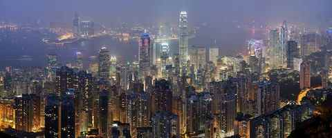

*Hong Kong skyline and Victoria Harbour. Photo: Diliff, CC BY 3.0, via [Wikimedia Commons](https://commons.wikimedia.org/wiki/File:Hong_Kong_Skyline_Restitch_-_Dec_2007.jpg)*

**Family travel journal · Hyderabad to Hong Kong and Macau**

**Hong Kong & Macau Family Adventure**

9–17 January 2027 · Karthik, his wife and their 8-year-old daughter

Animals and kid experiences · Shopping and local markets · Indian food

Karthik, his wife and their 8-year-old daughter: six nights in Hong Kong and two in Macau, with animal outings, hands-on fun, markets and Indian dinners. Includes hotel picks, a day-by-day plan with photos, a budget and taxi fares.

## Flights

* **Outbound:** Cathay Pacific nonstop, Sat 9 Jan, HYD 2:05 AM to HKG 9:40 AM, 5 hr 5 min
* **Return:** CX 601, Sun 17 Jan, HKG 9:05 PM to HYD 12:50 AM (18 Jan), 6 hr 15 min
* **Fare:** $552 round trip per adult on Google Flights, about $1,650 for three
* **Status:** Chosen, not booked yet

## Trip at a glance

| Date | Main outing | Animals | Shopping |
| --- | --- | --- | --- |
| Sat 9 | Arrive, Mong Kok walk | Aviary, birds, goldfish | Ladies' Market |
| Sun 10 | Dolphin boat trip | Pink dolphins | Harbour City |
| Mon 11 | Ngong Ping 360 |  | Citygate Outlets |
| Tue 12 | Disneyland |  |  |
| Wed 13 | Ocean Park | Pandas, sea lions |  |
| Thu 14 | Zoo, trams, Peak | Zoo | Temple Street |
| Fri 15 | To Macau, Dancing Water |  | Senado Square |
| Sat 16 | Pandas, Taipa | Giant pandas | Rua do Cunha |
| Sun 17 | Red Market, fly home |  | Red Market |

January is cool, with highs around 19°C and lows around 15°C, so pack layers and a light jacket.

## Day by day

### Jan 9

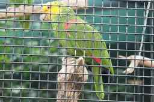

*A parrot in the Kowloon Park aviary. Photo: J Aaron Farr, CC BY 2.0, via [Wikimedia Commons](https://commons.wikimedia.org/wiki/File:Amazona_oratrix_-Kowloon_Park_Aviary-4a.jpg)*

**Day 1 of 9 · Sat 9 Jan**

**Arrive, birds, fish and Ladies' Market**

Arrive, then birds, goldfish and a stroll through Ladies' Market, ending with a vegetarian Indian dinner on Mody Road.

Animals · Shopping · Indian food

| When | Activity | What it is and plan notes | What to do there |
| --- | --- | --- | --- |
| 9:40 AM | Land at HKG on Cathay nonstop | Hong Kong International Airport is on Lantau island, about 35 km by road from the hotel (approx). Airport Express to Kowloon, then taxi to the hotel (Airport Express is HK$105 adult, HK$52.50 child). A cheaper option is the Citybus A21 to the Mody Road stop, see Taxi fares. Drop bags and rest. | 1) Have passports and the printed Pre-arrival Registration slips ready at immigration  2) Buy a Tourist Octopus card for MTR, trams and buses  3) Ask the hotel to hold bags if the room is not ready |
| Afternoon | Kowloon Park aviary and Discovery Playground | A large public park in the middle of Tsim Sha Tsui with a walk-in aviary of parrots and other birds, ponds and a big children's playground. Flamingos and parrots. Free, aviary closes 5:45 PM. | 1) Walk through the aviary and let her name the birds she spots  2) Spend half an hour at the Discovery Playground to burn off the flight  3) Walk the pond paths on the way out |
| 3:30 PM | Mong Kok animal and market walk | Three neighbouring Mong Kok sights: a garden street where songbirds are kept in small cages, a street of shops displaying goldfish in plastic bags, and the Tung Choi Street market of clothes, toys and souvenirs. Yuen Po Bird Garden before 4 PM, the Goldfish Market, then Ladies' Market once the street goes pedestrian at 4 PM. Shopping slot. | 1) Watch the bird keepers and the hanging cages at Yuen Po  2) Count the colours of fish on Goldfish Market street  3) At Ladies' Market choose one souvenir and practise a polite counter-offer |
| Dinner | Woodlands or Sangeetha, Mody Road, TST | Two vegetarian Indian restaurants a few minutes on foot from the hotel. Pure vegetarian Indian. Woodlands thalis are HK$129 (South Indian), HK$142 (North Indian) and HK$183 (Special), lunch 11:30 AM to 3:30 PM and dinner 6:00 to 10:30 PM. | 1) Order a South Indian thali (HK$129) or a North Indian thali (HK$142)  2) Ask for the child's portion to be mild  3) Walk back along Mody Road to the hotel |

#### Keep in mind

- You land at 9:40 AM after a 5 hr 5 min flight. Hong Kong is only 2.5 hours ahead of India, so keep the first afternoon light.
- Carry passports (valid 6+ months), the printed Pre-arrival Registration slips and some HKD cash for market stalls.
- Kowloon Park aviary closes 5:45 PM. Yuen Po Bird Garden is best before 4 PM. Ladies' Market is pedestrian-only from 4 PM.
- January is cool, about 15 to 19 C, so carry a light jacket.
- Expect a lot of walking. MTR from East Tsim Sha Tsui to Prince Edward is HK$5.90 adult and HK$3.20 child if small legs tire.
- Markets are crowded. Agree on a meeting point and hold her hand.
- Optional swap: the Hong Kong Science Museum instead of the Mong Kok walk. It is open to 9 PM on Saturday, HK$20 adult and HK$10 concession. Arrive about 4 PM for the 5 PM Energy Machine.

#### More photos (Wikimedia Commons)

* [Kowloon Park aviary parrot. Photo: J Aaron Farr, CC BY 2.0, via Wikimedia Commons](https://upload.wikimedia.org/wikipedia/commons/thumb/4/40/Amazona_oratrix_-Kowloon_Park_Aviary-4a.jpg/960px-Amazona_oratrix_-Kowloon_Park_Aviary-4a.jpg)
* [Yuen Po Street Bird Garden. Photo: Wing1990hk, CC BY 3.0, via Wikimedia Commons](https://upload.wikimedia.org/wikipedia/commons/thumb/4/46/Yuen_Po_Street_Bird_Garden_View_2012.jpg/960px-Yuen_Po_Street_Bird_Garden_View_2012.jpg)
* [Mong Kok Road and Tung Choi Street. Photo: Mk2010, CC BY-SA 3.0, via Wikimedia Commons](https://upload.wikimedia.org/wikipedia/commons/thumb/0/09/Mong_Kok_Road_and_Tung_Choi_Street_%28Hong_Kong%29.jpg/960px-Mong_Kok_Road_and_Tung_Choi_Street_%28Hong_Kong%29.jpg)

### Jan 10

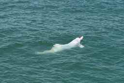

*A Chinese white dolphin off Lantau Island. Photo: Leonard Reback, CC BY-SA 4.0, via [Wikimedia Commons](https://commons.wikimedia.org/wiki/File:Chinese_white_dolphin.jpg)*

**Day 2 of 9 · Sun 10 Jan**

**Pink dolphins and Harbour City**

A boat trip to look for pink dolphins, then shopping at Harbour City.

Animals · Kid favourite · Shopping

| When | Activity | What it is and plan notes | What to do there |
| --- | --- | --- | --- |
| 8:50 AM | Hong Kong Dolphinwatch boat trip | A boat trip to waters north of Lantau to look for Chinese white dolphins, locally called pink dolphins. Sightings are never guaranteed. Pickup outside The Kowloon Hotel, TST. Back around 1 to 2 PM. Book ahead by email. HK$580 adult, HK$380 child. | 1) Scan the water from the deck and keep a family sighting tally  2) Ask the guide how the dolphins are monitored  3) Take photos of Lantau and the airport coast from the boat |
| Afternoon | Rest, then Harbour City and Ocean Terminal | A very large waterfront mall complex in Tsim Sha Tsui with children's and toy shops, plus the Ocean Terminal deck facing the harbour. Toy shops and kids' brands, waterfront views. Open 10 AM to 10 PM. Shopping slot. | 1) Let her pick one toy or book inside a set budget  2) Walk out to the Ocean Terminal deck for harbour views  3) Have a snack break and rest before the evening |
| 8:00 PM | A Symphony of Lights from the TST promenade | A free nightly light and music show on the Hong Kong Island skyline, watched from the Tsim Sha Tsui waterfront promenade. Free, about 10 minutes. | 1) Arrive about 10 minutes early to find a spot at the railing  2) Watch the buildings light up in time with the music  3) Stroll the promenade back toward the hotel |
| Backup | LEGOLAND Discovery Centre at K11 MUSEA if the boat doesn't run | An indoor LEGO play centre in the K11 MUSEA mall in Tsim Sha Tsui. An indoor option for a rainy or rough-sea day. | 1) Join a hands-on brick building zone  2) Check the centre's website for rides and shows before going  3) Book tickets online ahead |

#### Keep in mind

- Dolphinwatch pickup is 8:50 AM outside The Kowloon Hotel, TST. Booking is by email and must be done well ahead.
- Rough seas can cancel the boat. Carry seasickness tablets, a hat, sunscreen and a windproof layer.
- The trip returns around 1 to 2 PM. Eat a light breakfast and pack water and snacks.
- Harbour City is open 10 AM to 10 PM. It is large, so fix a shop list to save legs.
- Symphony of Lights is at 8 PM and is free. Show times can change in bad weather, so check on the day.
- Sunday crowds are heavy at the mall and promenade. Hold her hand.
- Optional swap: the Hong Kong Space Museum around 3 to 5 PM (open 10:00 to 21:00 on Sunday), halls HK$10 and a dome show HK$40 or 30, then walk to the promenade for 8 PM.

#### More photos (Wikimedia Commons)

* [Chinese white dolphin (location not confirmed as Hong Kong). Photo: Leonard Reback, CC BY-SA 4.0, via Wikimedia Commons](https://upload.wikimedia.org/wikipedia/commons/thumb/1/1c/Chinese_white_dolphin.jpg/960px-Chinese_white_dolphin.jpg)
* [A Symphony of Lights, Hong Kong. Photo: Krimuk2.0, CC BY-SA 4.0, via Wikimedia Commons](https://upload.wikimedia.org/wikipedia/commons/thumb/d/d9/Hong_Kong%2C_A_Symphony_of_Lights_%282%29.jpg/960px-Hong_Kong%2C_A_Symphony_of_Lights_%282%29.jpg)

### Jan 11

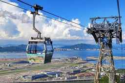

*The Ngong Ping 360 cable car. Photo: Sparktour, CC BY-SA 4.0, via [Wikimedia Commons](https://commons.wikimedia.org/wiki/File:Ngong_Ping_360_Cable_Car_and_HKG_2021-09.jpg)*

**Day 3 of 9 · Mon 11 Jan**

**Ngong Ping 360 and Citygate Outlets**

Ride the Ngong Ping 360 cable car to the Big Buddha, then shop at Citygate Outlets.

Kid favourite · Shopping

| When | Activity | What it is and plan notes | What to do there |
| --- | --- | --- | --- |
| 10:00 AM | Cable car to Ngong Ping and the Big Buddha | A scenic cable car ride over the sea and Lantau hills to Ngong Ping Village, home of the Tian Tan Buddha statue and Po Lin Monastery. Check the maintenance calendar in December. HK$295 adult, HK$150 child. | 1) Pick a spot by the glass for views of the sea and the airport  2) Climb the steps to the Tian Tan Buddha and look up close  3) Walk Ngong Ping Village and the monastery grounds, and find a vegetarian snack |
| Afternoon | Citygate Outlets, Tung Chung | An outlet mall with discounted brand shops next to the Tung Chung MTR station and the cable car terminal. Two minutes from the cable car. Open 10 AM to 10 PM. Shopping slot. | 1) Shop for children's and sports brands  2) Compare prices before buying  3) Have lunch at the mall and rest before the ride back |

#### Keep in mind

- The cable car can close for annual maintenance or in high winds. Recheck the maintenance calendar in December.
- Start by 10 AM to avoid queues. Book tickets online if the site offers it.
- Lantau hills are cooler and windier than the city. Carry a jacket.
- There are steps up to the Buddha. Pace it for a child.
- Citygate Outlets is open 10 AM to 10 PM, so you can shop after the cable car.
- The ride from the hotel to Tung Chung is long, about 30 km by road (approx), so pack snacks.

#### More photos (Wikimedia Commons)

* [Ngong Ping 360 cable car and Hong Kong airport. Photo: Sparktour, CC BY-SA 4.0, via Wikimedia Commons](https://upload.wikimedia.org/wikipedia/commons/thumb/a/ad/Ngong_Ping_360_Cable_Car_and_HKG_2021-09.jpg/960px-Ngong_Ping_360_Cable_Car_and_HKG_2021-09.jpg)
* [Tian Tan Buddha. Photo: Beria Lima de Rodriguez, CC BY-SA 3.0, via Wikimedia Commons](https://upload.wikimedia.org/wikipedia/commons/thumb/1/13/Tian_Tan_Buddha_by_Beria.jpg/960px-Tian_Tan_Buddha_by_Beria.jpg)
* [Citygate Outlets, Tung Chung. Photo: Qwer132477, CC BY-SA 4.0, via Wikimedia Commons](https://upload.wikimedia.org/wikipedia/commons/thumb/0/0f/Citygate_Outlets_In_Tung_Chung_2021_03_part1.jpg/960px-Citygate_Outlets_In_Tung_Chung_2021_03_part1.jpg)

### Jan 12

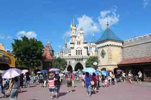

*Sleeping Beauty Castle, Hong Kong Disneyland. Photo: Deror_avi, CC BY-SA 3.0, via [Wikimedia Commons](https://commons.wikimedia.org/wiki/File:Disneyland_Hong_Kong_-_Sleeping_Beauty_Castle_IMG_5416.JPG)*

**Day 4 of 9 · Tue 12 Jan**

**Hong Kong Disneyland**

A full day at Hong Kong Disneyland.

Kid favourite

| When | Activity | What it is and plan notes | What to do there |
| --- | --- | --- | --- |
| Full day | Hong Kong Disneyland | Disney's Hong Kong theme park on Lantau, with a castle, family rides, character meetings and live shows. Buy tickets, then reserve the park date. Use the app for show and parade times. HK$1,837 to HK$2,583 for 3, by date tier. Tue 12 Jan is listed as Tier 1. | 1) Go to the family rides first thing and save shows for midday  2) Meet characters and use the app for wait and show times  3) Finish with the castle show or parade if it runs that day |

#### Keep in mind

- Tickets are tiered by date. The tier for 12 Jan comes from a third-party calendar, so confirm it on the official calendar when you buy.
- Buy tickets and reserve the park date before you go. Entry needs a reservation.
- Take the MTR to Sunny Bay, then the Disneyland Resort line (HK$22.20 adult, HK$11.10 child from East TST).
- Carry a power bank for the app, a light jacket, water and snacks. Look for vegetarian options at park restaurants and check with staff.
- Rides have height limits, so check before queuing.
- Check park closing time and the parade or fireworks schedule in the app that morning.

#### More photos (Wikimedia Commons)

* [Sleeping Beauty Castle, Hong Kong Disneyland. Photo: Deror_avi, CC BY-SA 3.0, via Wikimedia Commons](https://upload.wikimedia.org/wikipedia/commons/thumb/f/f0/Disneyland_Hong_Kong_-_Sleeping_Beauty_Castle_IMG_5416.JPG/960px-Disneyland_Hong_Kong_-_Sleeping_Beauty_Castle_IMG_5416.JPG)
* [Hong Kong Disneyland castle. Photo: David Quitoriano (Dave Q), CC BY 2.0, via Wikimedia Commons](https://upload.wikimedia.org/wikipedia/commons/2/28/Hong_Kong_Disneyland_Castle_by_Dave_Q.jpg)

### Jan 13

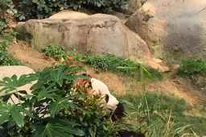

*A giant panda at Ocean Park. Photo: 永愛所有小貓咪, CC BY-SA 4.0, via [Wikimedia Commons](https://commons.wikimedia.org/wiki/File:Ocean_Park_Giant_Panda.jpg)*

**Day 5 of 9 · Wed 13 Jan**

**Ocean Park**

Pandas and sea lions at Ocean Park, then an easy thali dinner near the hotel.

Animals · Kid favourite · Indian food

| When | Activity | What it is and plan notes | What to do there |
| --- | --- | --- | --- |
| 10:00 AM | Ocean Park, pandas and sea life | A marine-themed park on the south side of Hong Kong Island with giant pandas, aquariums, animal feedings and rides. Catch the free sea lion and fish feedings. Penguin Expedition is paused until March, and the paid panda session is HK$1,880 a head, so skip it. HK$538 adult, HK$269 child. | 1) See the giant pandas at the panda habitat  2) Catch the free sea lion and fish feedings  3) Ride the cable car or train between the park's two areas and try a few family rides |
| Evening | Easy night near the hotel | A rest evening after a full day on your feet. Early dinner on Mody Road. | 1) Have an early thali at Woodlands or Sangeetha  2) Pack and charge phones for tomorrow  3) Take a short promenade stroll if energy allows |

#### Keep in mind

- MTR goes direct from East TST to Ocean Park station (HK$13.20 adult, HK$6.50 child). The park gate is right by the station.
- Penguin Expedition is paused until March, so do not plan around it.
- Skip the paid panda session at HK$1,880 a head. The free viewing is enough.
- Check the day's feeding and show times at the gate and plan the day around them.
- It is a hilly, large park. Wear comfortable shoes and pack a layer.
- Check closing time on the day.

#### More photos (Wikimedia Commons)

* [Giant panda at Ocean Park. Photo: yong ai suo you xiao mao mi, CC BY-SA 4.0, via Wikimedia Commons](https://upload.wikimedia.org/wikipedia/commons/thumb/e/e2/Ocean_Park_Giant_Panda.jpg/960px-Ocean_Park_Giant_Panda.jpg)
* [Ocean Park, Hong Kong. Photo: LN9267, CC BY-SA 4.0, via Wikimedia Commons](https://upload.wikimedia.org/wikipedia/commons/thumb/f/f1/Ocean_Park%2C_Hong_Kong_22-06-2025%2834%29.jpg/960px-Ocean_Park%2C_Hong_Kong_22-06-2025%2834%29.jpg)

### Jan 14

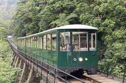

*The Peak Tram. Photo: LN9267, CC BY-SA 4.0, via [Wikimedia Commons](https://commons.wikimedia.org/wiki/File:Peak_Tram(Green_light)_10-09-2022(2).jpg)*

**Day 6 of 9 · Thu 14 Jan**

**Zoo, trams, Peak and Temple Street**

The zoo, the trams and the Peak by day, Temple Street Night Market by night.

Animals · Shopping

| When | Activity | What it is and plan notes | What to do there |
| --- | --- | --- | --- |
| 9:00 AM | Hong Kong Zoological and Botanical Gardens | A compact public zoo and garden on a hillside in Central. Free. Monkeys, birds and reptiles in Central. | 1) Spot the monkeys and the birds  2) Visit the reptile area  3) Stroll the gardens before the heat of the day |
| Late morning | Ding Ding tram ride, then the Peak Tram and Sky Terrace | Hong Kong's double-decker trams run along the north shore of the island. The Peak Tram is a steep funicular up to Victoria Peak and the Sky Terrace viewing deck. Peak combo HK$182 adult, HK$118 child. Tram fare is HK$3.30 adult, HK$1.60 child per ride. | 1) Sit upstairs at the front of the double-decker tram  2) Ride the Peak Tram and look over the skyline from the Sky Terrace  3) Take a short flat walk around the Peak |
| 2 to 5 PM | Rest at the hotel | A planned rest to protect the evening. Break before the night market. | 1) Nap or read  2) Light snack  3) Check the next day's ferry time |
| 6:00 PM | Temple Street Night Market | A street market in Yau Ma Tei with souvenir and goods stalls, street food and fortune tellers. Street food and stalls, closes around midnight. Shopping slot. | 1) Choose a small souvenir  2) Try vegetarian snack stalls and check ingredients  3) Watch the fortune-teller stalls near the temple |

#### Keep in mind

- The Peak queues grow by late morning. Go early or buy the combo ticket (HK$182 adult, HK$118 child) ahead.
- The Peak is cooler and windier than the city. Carry a jacket.
- Taxis to Hong Kong Island pay harbour tunnel tolls, so MTR to Central is much cheaper.
- The zoo is on a slope. Expect uphill walking.
- Temple Street comes alive in the evening and closes around midnight. Watch pockets and keep your daughter close.
- Keep the 2 to 5 PM rest so she is fresh for the night market.

#### More photos (Wikimedia Commons)

* [Hong Kong Zoological and Botanical Gardens. Photo: RG72, CC BY-SA 4.0, via Wikimedia Commons](https://upload.wikimedia.org/wikipedia/commons/thumb/3/3e/Hong_Kong_Zoological_and_Botanical_Gardens_20.jpg/960px-Hong_Kong_Zoological_and_Botanical_Gardens_20.jpg)
* [Peak Tram. Photo: LN9267, CC BY-SA 4.0, via Wikimedia Commons](https://upload.wikimedia.org/wikipedia/commons/thumb/1/17/Peak_Tram%28Green_light%29_10-09-2022%282%29.jpg/960px-Peak_Tram%28Green_light%29_10-09-2022%282%29.jpg)
* [Temple Street market. Photo: Diego Delso, CC BY-SA 3.0, via Wikimedia Commons](https://upload.wikimedia.org/wikipedia/commons/thumb/7/73/Mercado_en_Temple_St.%2C_Hong_Kong%2C_2013-08-11%2C_DD_01.JPG/960px-Mercado_en_Temple_St.%2C_Hong_Kong%2C_2013-08-11%2C_DD_01.JPG)

### Jan 15

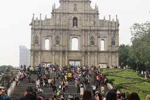

*Ruins of St Paul's, Macau. Photo: Joybot, CC BY-SA 2.0, via [Wikimedia Commons](https://commons.wikimedia.org/wiki/File:Ruins_of_St_Paul%27s,_Macau_(30843847251).jpg)*

**Day 7 of 9 · Fri 15 Jan**

**To Macau, House of Dancing Water**

Travel to Macau and settle in at the Sofitel, then The House of Dancing Water.

Kid favourite · Shopping

| When | Activity | What it is and plan notes | What to do there |
| --- | --- | --- | --- |
| Morning | TurboJET ferry, Sheung Wan to Macau | A fast catamaran from the Hong Kong-Macau Ferry Terminal in Sheung Wan to Macau. About 60 minutes. About HK$564 for 3, weekday. | 1) Keep passports handy for immigration at both ends  2) Sit together and stow bags in the racks  3) Watch the harbour and bridges from the window |
| Afternoon | Check in, stroll Ruins of St Paul's and Senado Square | The Ruins are the carved stone front of a 17th-century church, part of Macau's UNESCO-listed historic centre. Senado Square is the wave-patterned pavement square nearby. Shopping slot. | 1) Climb the steps at the Ruins for photos  2) Walk Senado Square's wave pavement  3) Sample almond cookies from the nearby shops |
| 7:30 PM | House of Dancing Water, City of Dreams | A large water-stage show with acrobats and divers, performed at City of Dreams. Ages 6+. Book ahead. MOP 698 to 1,598 per seat. | 1) Arrive about 30 minutes early  2) Choose a seat tier by view and budget  3) Carry a light layer for the theatre |

#### Keep in mind

- Carry passports. Macau needs a return ticket, hotel booking and proof of MOP 5,000 per person.
- Use MOP in Macau. Many places also accept HKD but check.
- House of Dancing Water suits ages 6+ and sells out, so book ahead. A flash sale runs 28 Oct to 6 Nov 2026 for shows from 29 Oct 2026 to 31 Mar 2027.
- Check the show start time and the day of the week for tickets.
- The Ruins are on a slope with steps and crowded by afternoon.
- Keep taxis for luggage legs (ferry to hotel) and use feet for Senado and the Ruins.

#### More photos (Wikimedia Commons)

* [A TurboJET boat leaving for Macau. Photo: shankar s., CC BY 2.0, via Wikimedia Commons](https://upload.wikimedia.org/wikipedia/commons/thumb/5/50/Turbo_Jet_boat_leaves_for_Macau_%287822072108%29.jpg/960px-Turbo_Jet_boat_leaves_for_Macau_%287822072108%29.jpg)
* [The House of Dancing Water interior. Photo: Solomon203, CC BY-SA 4.0, via Wikimedia Commons](https://upload.wikimedia.org/wikipedia/commons/thumb/2/28/The_House_of_Dancing_Water_interior_20180525.jpg/960px-The_House_of_Dancing_Water_interior_20180525.jpg)
* [Ruins of St Paul's, Macau. Photo: Joybot, CC BY-SA 2.0, via Wikimedia Commons](https://upload.wikimedia.org/wikipedia/commons/thumb/5/58/Ruins_of_St_Paul%27s%2C_Macau_%2830843847251%29.jpg/960px-Ruins_of_St_Paul%27s%2C_Macau_%2830843847251%29.jpg)

### Jan 16

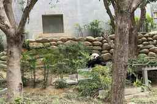

*The Macao Giant Panda Pavilion. Photo: LN9267, CC BY-SA 4.0, via [Wikimedia Commons](https://commons.wikimedia.org/wiki/File:Macao_Giant_Panda_Pavilion_18-02-2024(15).jpg)*

**Day 8 of 9 · Sat 16 Jan**

**Pandas and Taipa Village**

Giant pandas at the Panda Pavilion, then Taipa Village and a thali dinner.

Animals · Shopping · Indian food

| When | Activity | What it is and plan notes | What to do there |
| --- | --- | --- | --- |
| 10:00 AM | Giant Panda Pavilion, Coloane | Macau's panda house, in the Seac Pai Van park on Coloane. Free. 10:00 to 13:00 and 14:00 to 17:00. | 1) Watch the pandas through the viewing windows  2) Walk the Seac Pai Van park around the pavilion  3) Use the morning session, when the pavilion is quieter |
| Lunch | Taipa Village and Rua do Cunha | The old village streets of Taipa with Portuguese-style buildings, snack shops and souvenir stores. Snacks, souvenirs, Taipa Houses. Shops until about 9 PM. Shopping slot. | 1) Walk Rua do Cunha and browse the snack shops  2) Pick up almond cookies or peanut candy  3) Look at the colourful Taipa Houses |
| Late afternoon | Rest, or Macao Science Center as a swap | A science museum with hands-on exhibits. Exhibition MOP 50. | 1) Try the hands-on exhibits  2) Check the website for any extra shows  3) Or rest back at the hotel |
| Dinner | Woodlands Macau or Taal | Indian restaurants on the Macau peninsula. Both on the peninsula. Woodlands Macau thalis are MOP 118, 128, 138 and 158. | 1) Order a thali at Woodlands Macau  2) Share a dessert  3) Be back in the hotel early for the final day |

#### Keep in mind

- Panda Pavilion is free and open 10:00 to 13:00 and 14:00 to 17:00. Check the Macao tourism page for closure days.
- Taxis to Coloane carry a surcharge, see Taxi fares.
- Taipa Village shops run until about 9 PM.
- Saturday brings crowds. Start with the pandas.
- Taipa Village streets are walkable but busy. Keep a hand on her.
- Plan only one major stop in the afternoon.
- Optional swap: teamLab SuperNature in Cotai after the pandas and lunch, about 2 hours. MOP 288 adult and MOP 208 child, last entry 6:15 PM, and check the schedule first as Wednesdays are dark in 2026.

#### More photos (Wikimedia Commons)

* [Macao Giant Panda Pavilion. Photo: LN9267, CC BY-SA 4.0, via Wikimedia Commons](https://upload.wikimedia.org/wikipedia/commons/thumb/3/3f/Macao_Giant_Panda_Pavilion_18-02-2024%2815%29.jpg/960px-Macao_Giant_Panda_Pavilion_18-02-2024%2815%29.jpg)
* [Taipa Village, Rua do Cunha. Photo: travel oriented, CC BY-SA 2.0, via Wikimedia Commons](https://upload.wikimedia.org/wikipedia/commons/thumb/0/0f/Macau_Taipa_Village_-_Rua_do_Cunha_%2812354319294%29.jpg/960px-Macau_Taipa_Village_-_Rua_do_Cunha_%2812354319294%29.jpg)

### Jan 17

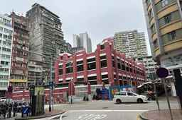

*Red Market, Macau. Photo: LN9267, CC BY-SA 4.0, via [Wikimedia Commons](https://commons.wikimedia.org/wiki/File:Red_Market_18-03-2024.jpg)*

**Day 9 of 9 · Sun 17 Jan**

**Red Market, fly home**

A morning at Red Market, then the journey back to Hong Kong airport for the 9:05 PM flight home.

Shopping

| When | Activity | What it is and plan notes | What to do there |
| --- | --- | --- | --- |
| Morning | Red Market and Senado souvenirs | Red Market is a covered market hall with fresh food stalls. Senado Square has souvenir and biscuit shops. Almond cookies and snacks. Market opens 7 AM. Shopping slot. | 1) Walk the market stalls  2) Buy almond cookies and snacks to take home  3) Pick up last souvenirs |
| 2:00 PM | Leave Macau for HKG | Cross the Hong Kong-Zhuhai-Macao Bridge by bus, then continue to the airport. HZMB bridge bus to the HK Port, then the airport shuttle. HK$65 adult, HK$33 child. | 1) Pass Macau and Hong Kong immigration with passports ready  2) Collect bags and tickets  3) Keep a buffer for bridge queues |
| 9:05 PM | CX 601 to Hyderabad | The Cathay Pacific nonstop home, 6 hr 15 min. Lands 12:50 AM on Jan 18. | 1) Check in early  2) Eat before boarding  3) Spend or change leftover currency |

#### Keep in mind

- Red Market opens at 7 AM.
- Leave Macau about 2 PM for an evening flight. The bridge bus adds immigration queues at both ends.
- MOP is not generally used in Hong Kong. Spend leftover MOP before leaving.
- Pack bags the night before and check hotel checkout time.
- The flight lands in Hyderabad at 12:50 AM on 18 Jan. Plan a ride home in advance.
- Taxis for luggage legs (hotel to port, HK port to airport) are fine, or use the shuttle bus.

#### More photos (Wikimedia Commons)

* [Red Market, Macau. Photo: LN9267, CC BY-SA 4.0, via Wikimedia Commons](https://upload.wikimedia.org/wikipedia/commons/thumb/8/82/Red_Market_18-03-2024.jpg/960px-Red_Market_18-03-2024.jpg)
* [Senado Square, Macau. Photo: Jacklee., CC BY-SA 3.0, via Wikimedia Commons](https://upload.wikimedia.org/wikipedia/commons/thumb/f/f1/Senado_Square%2C_Macau_-_20101117.jpg/960px-Senado_Square%2C_Macau_-_20101117.jpg)
* [Hong Kong Port of the Hong Kong-Zhuhai-Macao Bridge. Photo: N509FZ, CC BY-SA 4.0, via Wikimedia Commons](https://upload.wikimedia.org/wikipedia/commons/thumb/8/8c/Hong_Kong_Port_of_Hong_Kong-Zhuhai-Macao_Bridge_%2820181006170655%29.jpg/960px-Hong_Kong_Port_of_Hong_Kong-Zhuhai-Macao_Bridge_%2820181006170655%29.jpg)

## All activities in Hong Kong & Macau

A catalog of 36 Hong Kong and 23 Macau activities for a family with an 8-year-old, checked against official pages on 30 Oct 2026. Prices are HK$ in Hong Kong and MOP in Macau, adult first and then child. The word check means I could not confirm it. Time needed is an estimate. The In plan column says whether it is already in your days, or which day it could swap into.

> [!WARNING]
> **Not available in January 2027.** Sky100 is closed for renovation with no reopening date. Ocean Park Water World has no dates after its 20 Dec 2026 winter event. The Hong Kong Pokémon Centre pop-up at Festival Walk runs 11 Nov 2026 to 3 Jan 2027, so it ends before you arrive. Ocean Park's Hello Kitty and Sanrio event ended 23 Aug 2026. Macau's Fisherman's Wharf no longer has rides.

### Weekday closures for your dates

- Science Museum is closed Thu 14 Jan (open Tue 12 Jan) and free on Wed 13 Jan.
- Museum of History, Palace Museum, Space Museum, Heritage Museum and Wetland Park are closed Tue 12 Jan. The Space Museum halls are free on Wed 13 Jan.
- teamLab SuperNature Macao is dark on Wednesdays in the 2026 schedule. The January 2027 schedule is not out yet, so check before buying for Sat 16 Jan.
- M+ is closed Mon 11 Jan, and its Design Ah! exhibition ends Sun 10 Jan.
- Noah's Ark is closed Wed 13 Jan.
- Macao Science Center is closed Thursdays, so Sat 16 Jan is fine. Panda Pavilion and Taipa Houses are closed Mondays.

### Parks and animals

| Activity | Area | What it is | Kids (age 8) | Price | Time | In plan | Official link |
| --- | --- | --- | --- | --- | --- | --- | --- |
| Noah's Ark | Ma Wan | Life-size ark with animal and nature exhibits, plus a nature garden. Open 10:00 to 18:00, closed Wednesdays. | High, animal themed | HK$198 / 158 (age 3 to 11). Central ferry HK$36 / 18 | 4 to 5 hr with ferry | Optional extra. Closed Wed 13 Jan | <https://www.noahsark.com.hk/eng/noahs-ark-tickets.jsp> |
| Edward Youde Aviary, Hong Kong Park | Admiralty | Walk-through aviary with tropical birds, free entry, 09:00 to 17:00 daily. | High, birds up close | Free | 1 hr | Swap idea: Thu 14 Jan, before the Peak | <https://hkp.lcsd.gov.hk/en/facilities/aviary> |
| Hong Kong Wetland Park | Tin Shui Wai | Wetland reserve with birds and walking trails. Open 10:00 to 17:00, closed Tuesdays. Visitor centre galleries are closed for upgrading, so check what is open. | Medium, mostly walking | HK$30 / 15 (age 3 to 17) | 2 to 3 hr | Optional extra. Closed Tue 12 Jan | <https://www.wetlandpark.gov.hk/en/information/ticketing> |
| Mai Po Nature Reserve | Mai Po, New Territories | WWF reserve at peak winter bird migration in January. Book a WWF guided visit, since entry otherwise needs a permit. | Check age rules; long quiet walks | check | Half day | Optional extra for bird lovers | <https://www.wwf.org.hk/en/wetlands/booking/> |
| Snoopy's World | Sha Tin, New Town Plaza | Free outdoor Snoopy playground and photo spots on Level 3, open 11:00 to 19:00 daily. | Good for photos, short stop | Free | 1 hr | Pair with the Heritage Museum | <https://www.newtownplaza.com.hk/zh-hans/snoopys-world/> |
| Ocean Park | Aberdeen | Pandas, sea lions and rides. Check the park notices page for closed attractions. | High | HK$538 / 269 (from your plan) | Full day | In plan, Day 13 (Wed 13 Jan) | <https://www.oceanpark.com.hk/en> |
| Ocean Park Water World | Aberdeen | Water park. The winter Year End Splash runs 1 Nov to 20 Dec 2026, and I found no January dates, so treat it as closed. | Not usable in January | check | n/a | Dropped, likely closed in Jan 2027 | <https://waterworld.oceanpark.com.hk/en/plan-your-visit/park-hours-schedule/> |
| Hong Kong Disneyland | Lantau | Theme park, ticket tiers are in the Budget section. | High | By tier, see Budget | Full day | In plan, Day 12 (Tue 12 Jan) | <https://www.hongkongdisneyland.com/> |
| Giant Panda Pavilion (Macau) | Seac Pai Van Park, Coloane | Free pandas. Open 10:00 to 13:00 and 14:00 to 17:00, last entry 16:45, closed Mondays. | High | Free | 1 to 2 hr | In plan, Day 16 (Sat 16 Jan) | <https://www.macaotourism.gov.mo/en/events/whatson/13928> |
| Studio City Water Park (Macau) | Cotai | Indoor area stays open at 30 degrees, the outdoor area is closed 2 Nov 2026 to 29 Apr 2027. Open 12:00 to 20:00 with some dark days. | High, indoor in winter | Winter MOP 398 standard, MOP 258 child (1 to 1.19 m) | 3 to 4 hr | Swap idea: Fri 15 Jan afternoon, a rain or tired-legs option | <https://studiocity-macau.com/en/attractions/studio-city-water-park> |
| Qube Kingdom (Macau) | Parisian Macao, Cotai | Family attraction at Parisian, open daily 11:00 to 19:00. | High | MOP 180 weekday or 220 weekend for 1 adult + 1 child; other group sizes check | 2 hr | Optional extra | <https://www.cotaiticketing.com/shows/qubekingdom.html> |

### Museums and hands-on

| Activity | Area | What it is | Kids (age 8) | Price | Time | In plan | Official link |
| --- | --- | --- | --- | --- | --- | --- | --- |
| Hong Kong Science Museum | Tsim Sha Tsui East | Hands-on science halls a few minutes' walk from your hotel. Open 10:00 to 19:00 Mon, Tue, Wed and Fri, to 21:00 Sat, Sun, holidays. Closed Thursdays, so not Thu 14 Jan. Energy Machine runs at 11:00, 14:00 and 17:00. | High, hands-on, Children's Gallery up to 160 cm | HK$20 adult, HK$10 concession (child, with student proof). Free on Wednesdays | 2 to 3 hr | Swap idea: Sat 9 Jan afternoon or evening after check-in | <https://hk.science.museum/en/web/scm/index.html> |
| Hong Kong Space Museum | Tsim Sha Tsui | Space exhibits and OMNIMAX dome shows at the Stanley Ho Space Theatre. Open 13:00 to 21:00 Mon and Wed to Fri, 10:00 to 21:00 on weekends, closed Tuesdays, so not Tue 12 Jan. | High, dome shows (about 28 min) | Halls HK$10 (HK$5 concession, free Wednesdays). Space Theatre HK$40 or 30 | 2 hr | Swap idea: Sun 10 Jan afternoon, before the evening harbour lights | <https://hk.space.museum/en/web/spm/visit-and-facilities.html> |
| Hong Kong Museum of History | Tsim Sha Tsui East | The Hong Kong Story permanent exhibition, free from 1 Apr 2026. Closed Tuesdays. Allow 2+ hours. | Medium, good rainy-day option | Free (special exhibitions may charge) | 2 to 3 hr | Rain swap, any day except Tue 12 Jan | <https://hk.history.museum/en/web/mh/index.html> |
| Hong Kong Palace Museum | West Kowloon | Chinese palace treasures. Galleries 1 to 7 are general admission, special exhibitions cost extra. Closed Tuesdays. | Medium, 7 and above get concession | HK$70 / 35 (age 7 to 11). Under 7 free with booking | 2 hr | Rain swap, Thu 14 Jan (open until 18:00) | <https://www.hkpm.org.hk/en/visit/ticket> |
| M+ museum | West Kowloon | Visual culture museum. The interactive Design Ah! family exhibition ends 10 Jan 2027, so only Sat 9 and Sun 10 overlap. Closed Mondays. | High for Design Ah!, medium otherwise | HK$190 / 100 (age 7 to 11). Family combos HK$250 (1+1), HK$400 (2+1) | 2 hr | Swap idea: Sun 10 Jan morning | <https://www.mplus.org.hk/en/admission-tickets/> |
| Hong Kong Heritage Museum | Sha Tin | Free permanent exhibitions including the Children's Discovery Gallery. Open 10:00 to 18:00 (19:00 weekends), closed Tuesdays. | High, kids' gallery | Free | 2 hr | Pair with Snoopy's World in Sha Tin | <https://hk.heritage.museum/en/exhibitions/childrens_discovery.html> |
| Hong Kong Maritime Museum | Central Pier 8 | Ships and harbour history on the Central waterfront. | Medium | HK$30 / 15 (age 3 to 18) | 1 to 2 hr | Optional extra near the Star Ferry | <https://www.hkmaritimemuseum.org/plan-your-visit> |
| Hong Kong Railway Museum | Tai Po | Old trains you can walk through. Free, 10:00 to 18:00, closed Tuesdays. | High for train fans | Free | 1 hr | Optional extra | <https://www.heritagemuseum.gov.hk/en/branch_museum/railway.html> |
| Tai Kwun | Central | Restored police station and prison. Site is free 08:00 to 23:00, heritage exhibitions 11:00 to 19:00. | Medium | Free | 1 to 2 hr | Optional extra near Central | <https://www.taikwun.hk/en/visit/visiting_information> |
| LEGOLAND Discovery Centre | K11 MUSEA, Tsim Sha Tsui | Indoor LEGO play centre, open 11:00 to 19:00 (last entry 18:00). | High | check | 2 to 3 hr | In plan, Day 10 backup | <https://www.legolanddiscoverycentre.com/hong-kong/> |
| Macao Science Center (Macau) | Macau Peninsula | Exhibition Centre open 10:00 to 18:00, closed Thursdays. MSC Kids World is for ages 2 to 12. | High, hands-on | Exhibition MOP 50. Planetarium 2D MOP 60, 3D MOP 80. Kids World MOP 35 | 3 hr | In plan as a swap, Day 16 | <https://www.msc.org.mo/en/article-detail/11/ticketing> |
| teamLab SuperNature Macao (Macau) | Cotai Expo, Venetian | Immersive digital art rooms. Open 11:00 to 19:00, last entry 18:15. The 2026 schedule has Wednesdays dark and no January 2027 schedule is out yet, so check before you buy. | High, interactive | MOP 288 adult, MOP 208 child (age 3 to 12), family of three MOP 784 | 2 hr | Swap idea: Sat 16 Jan afternoon, after the pandas and Taipa lunch | <https://www.cotaiticketing.com/shows/teamlab.html> |
| Macao Grand Prix Museum and Wine Museum (Macau) | Macau Peninsula | Racing cars and bikes. Open 10:00 to 18:00, closed Tuesdays. The Wine Museum is in the same building, its price and hours check. | Medium to high for car fans | MOP 80 standard, 40 concession (child rule check) | 1 to 2 hr | Optional extra, not on Tue | <https://mgpm.macaotourism.gov.mo/en/about/ticketing> |
| Taipa Houses-Museum (Macau) | Taipa Village | Free colonial houses, 10:00 to 19:00, closed Mondays. | Low to medium | Free | 45 min | Add-on to Day 16 Taipa Village walk | <https://www.icm.gov.mo/en/housesmuseum/> |

### Views and landmarks

| Activity | Area | What it is | Kids (age 8) | Price | Time | In plan | Official link |
| --- | --- | --- | --- | --- | --- | --- | --- |
| Star Ferry | Tsim Sha Tsui to Central | Classic harbour crossing, about 10 minutes. Weekday adult upper deck HK$5, lower HK$4. Weekend adult HK$6.50 or 5.60. | High, cheap fun | Child HK$2.90 or 2.80 weekday, 3.90 or 3.70 weekend | 20 min | Swap idea: ride across on Thu 14 Jan evening | <https://www.starferry.com.hk/en/service> |
| Avenue of Stars and Symphony of Lights | Tsim Sha Tsui promenade | Free harbour promenade with the nightly light show. | Medium | Free | 1 hr | In plan, Day 10 | <https://www.discoverhongkong.com/eng/attractions.html> |
| Aqua Luna red-sail junk | Tsim Sha Tsui Pier 1 or Central Pier 9 | 45 minute Symphony of Lights cruise with a free drink. Departs 19:30 from Tsim Sha Tsui or 19:45 from Central. | High, boat ride | HK$340 / 240 (age 4 to 11) | 1 hr | Swap idea: Sun 10 Jan evening instead of watching from shore | <https://aqualuna.com.hk/experiences/symphony-of-lights-cruise-%e5%b9%bb%e5%bd%a9%e8%a9%a0%e9%a6%99%e6%b1%9f%e9%81%8a%e8%88%b9/> |
| Hong Kong Observation Wheel | Central waterfront | 60 m wheel with harbour views. Open 12:00 to 22:00 Mon to Thu, 11:00 to 23:00 Fri to Sun. | High, short | HK$20 / 10 (age 3 to 11) | 45 min | Swap idea: Thu 14 Jan, if the Peak queue is long | <https://hkow.hk/> |
| Peak Tram and Sky Terrace 428 | Central to Victoria Peak | Tram up to the Peak with a viewing terrace. | High | HK$182 / 118 combo (from your plan) | 3 hr | In plan, Day 14 | <https://www.thepeak.com.hk/en> |
| Sky100 observation deck | ICC, West Kowloon | The official site says it is closed for a major renovation, with the reopening date to be announced. | Not available | n/a | n/a | Dropped, closed | <https://www.sky100.com.hk/> |
| Macau Tower observation deck (Macau) | Macau Peninsula | Observation deck on the Macau Tower. | High | MOP 208 / 138 (age 3 to 11) | 1 to 2 hr | Swap idea: Fri 15 Jan late afternoon | <https://www.macautower.com.mo/en/observation-deck/> |
| Skywalk, AJ Hackett at Macau Tower (Macau) | Macau Peninsula | Walk outside the tower, evening adventure from 18:00 in winter. Skywalk is suitable from age 3, bungy needs age 14 and above. Prices include deck entry. | Skywalk only, exciting | Skywalk MOP 788; SkyJump MOP 2,188; bungy MOP 3,088 | 2 hr | Optional thrill for Karthik or his wife | <https://www.skyparkmacau.com/activities> |
| Golden Reel (Macau) | Studio City, Cotai | 130 m Ferris wheel, 14:00 to 20:00, with dark days. | High | MOP 100. Golden Reel + Stardust package MOP 190 | 30 min | Optional extra | <https://studiocity-macau.com/en/attractions/golden-reel> |
| Wynn Palace SkyCab (Macau) | Cotai | Free cable-car ride over the lake. Sun to Thu 16:00 to 22:00, Fri and Sat 16:00 to midnight. | High | Free | 30 min | Swap idea: Fri 15 Jan after teamLab | <https://www.wynnresortsmacau.com/en/wynn-palace/experiences/entertainment/sky-cab> |
| Venetian gondola rides (Macau) | Grand Canal Shoppes, Cotai | Indoor canal ride, 11:30 to 19:30. | High | Weekday MOP 165 / 130, weekend MOP 175 / 145 (child under 12) | 30 min | Optional extra, Fri 15 or Sat 16 Jan | <https://venetianmacao.com/hotel/amenities/gondola-rides.html> |
| Eiffel Tower deck (Macau) | Parisian Macao, Cotai | Level 37 deck MOP 98, Levels 6 and 7 MOP 20. | Medium | MOP 98 (Level 37). Child price check | 45 min | Optional extra | <https://www.cotaiticketing.com/shows/eiffeltower.html> |
| Ruins of St Paul's (Macau) | Macau Peninsula | Church facade open 24 hours. The Sacred Art Museum and Crypt are free, 09:00 to 18:00, with Tuesday closing after 14:00. | Medium | Free | 45 min | In plan, Day 15 (Fri 15 Jan) | <https://www.wh.gov.mo/en/content/visitor/> |

### Nature and islands

| Activity | Area | What it is | Kids (age 8) | Price | Time | In plan | Official link |
| --- | --- | --- | --- | --- | --- | --- | --- |
| Cheung Chau | Outlying island | Car-free island with a harbour, beaches and snacks. Ferry from Central Pier 5, weekday ordinary adult HK$16.7, Sunday adult HK$24.8. | High, no cars | Ferry child HK$8.3 weekday, 12.4 Sunday | Half day | Swap idea: Sun 10 Jan afternoon if the dolphin trip is off | <https://www.sunferry.com.hk/en/route-and-fare/timetable> |
| Lamma Island | Outlying island | Island with a family-friendly hike, listed on the Hong Kong Tourism Board family hikes page. | Medium, 1 to 2 hr walk | Ferry fare check | Half day | Optional extra | <https://www.discoverhongkong.com/eng/outdoors/family-friendly-hikes-in-hong-kong.html> |
| Tai O fishing village | West Lantau | Stilt houses and market. Ferries run from Tuen Mun, Tung Chung and Sha Lo Wan, not Central. | Medium | Free to walk; boat trips check | 2 hr | Add-on to Day 11 (Mon 11 Jan) | <https://www.np360.com.hk/> |
| Ngong Ping Village | Lantau | Village at the top of the cable car with Big Buddha and Po Lin Monastery nearby. The cable car has maintenance closures, none listed for January 2027. | High | Cable car HK$295 / 150 (from your plan) | Half day | In plan, Day 11 (Mon 11 Jan) | <https://www.np360.com.hk/> |
| Dragon's Back | Shek O, Hong Kong Island | About 8 km, 3 to 4 hours, moderate with steep steps. Bus 9 from Shau Kei Wan. | Hard for an 8-year-old, best for older kids | Free | 3 to 4 hr | Probably skip, or do only the first section | <https://www.discoverhongkong.com/eng/place-to-go/travel.guide-dragon-s-back.html> |
| Sai Kung Geopark boat tour | Sai Kung | Sunday boat tour of the Sai Kung geopark islands. Ages 6 to 75, 2 hours. Sunday dates are 10 and 17 Jan. | High, boat and sea arches | HK$480 per person | Half day | Only possible on Sun 10 Jan or Sun 17 Jan, both busy | <https://www.discoverhongkong.com/eng/outdoors/r2g-sai-kung-island-hopping-tour.html> |
| Nan Lian Garden and Chi Lin Nunnery | Diamond Hill | Chinese garden open 07:00 to 21:00 and a wooden nunnery open 09:00 to 16:30, both free. | Medium, calm | Free | 2 hr | Swap idea: shopping-slot replacement, with Wong Tai Sin | <https://www.lcsd.gov.hk/en/parks/nlg/> |
| Coloane Village and Hac Sa Beach (Macau) | Coloane | Quiet village and black sand beach, good for a walk in winter but not for swimming. | Medium, beach play | Free | 2 to 3 hr | Add-on to Day 16, same trip as the pandas | <https://www.macaotourism.gov.mo/en/sightseeing> |

### Markets and shopping

| Activity | Area | What it is | Kids (age 8) | Price | Time | In plan | Official link |
| --- | --- | --- | --- | --- | --- | --- | --- |
| Stanley Market | Stanley, Hong Kong Island | Seaside market for souvenirs and clothes. Most stalls open about 10:00 to 18:30. | Medium | Free to browse | 2 to 3 hr | Swap idea: replaces Citygate on Day 11 if you skip it | <https://hk-stanley-market.com/when-to-go.htm> |
| Mong Kok and Temple Street markets | Kowloon | Ladies' Market, Goldfish Market and Yuen Po Bird Garden, plus the Temple Street night market. | High, birds and fish | Free to browse | 2 hr each | In plan, Days 9 and 14 | <https://www.discoverhongkong.com/eng/attractions.html> |
| Fisherman's Wharf (Macau) | Macau Peninsula | Now a dining and shopping district only. The former theme-park rides are no longer operating. | Low | Free | 1 hr | Dropped as an activity | <https://www.fishermanswharf.com.mo/> |
| Senado Square and Red Market (Macau) | Macau Peninsula | Souvenir streets and the local Red Market. | Medium | Free to browse | 2 hr | In plan, Days 15 and 17 | <https://www.macaotourism.gov.mo/en/sightseeing> |

### Shows and night

| Activity | Area | What it is | Kids (age 8) | Price | Time | In plan | Official link |
| --- | --- | --- | --- | --- | --- | --- | --- |
| Xiqu Centre Tea House Theatre | West Kowloon | About 90 minutes of Cantonese opera highlights with tea and dim sum. Children under 6 not admitted. Listed shows are Fri 19:30, Sat 14:30 and 17:30, Sun 14:30, but the page shows an Aug to Dec 2026 season. | Medium, for older kids | HK$350 or 300. Family package HK$780 (2 standard + 2 concession) | 1.5 hr | January 2027 dates check | <https://cultural.cityline.com.hk/en/2026/theatreexperience.html> |
| The House of Dancing Water (Macau) | City of Dreams, Cotai | Water stage show. | High | MOP 698 to 1,598 (from your plan) | 1.5 hr | In plan, Day 15 (Fri 15 Jan) | <https://www.macaotourism.gov.mo/en/sightseeing> |
| Studio City Stardust (Macau) | Studio City, Cotai | Ride at Studio City, 12:00 to 20:00. | High | MOP 150 | 30 min | Optional extra | <https://studiocity-macau.com/en/attractions/studio-city-stardust> |
| Wynn Palace Performance Lake (Macau) | Cotai | Free fountain and light show. Every 30 minutes from noon to 18:00, then every 20 minutes to midnight. | High | Free | 15 min | Swap idea: after the SkyCab, Fri 15 Jan | <https://www.wynnresortsmacau.com/en/wynn-palace/experiences/entertainment/sky-cab> |

### Food

| Activity | Area | What it is | Kids (age 8) | Price | Time | In plan | Official link |
| --- | --- | --- | --- | --- | --- | --- | --- |
| Woodlands vegetarian Indian | Tsim Sha Tsui | Pure vegetarian Indian thalis, a few minutes from the hotel. | Easy, mild options | Thali HK$129 / 142 / 183 | 1 hr | In plan, Day 9 | <https://woodlandshk.com/tsim-sha-tsui/menu> |
| Lord Stow's Bakery (Macau) | Coloane Village | Original egg tart bakery, open 07:00 to 21:00 daily. The Express outlet is 10:00 to 18:00, closed Wednesdays. | High, egg tarts | check | 30 min | Add-on to Day 16, in Coloane | <https://lordstow.com/macau-outlets/> |

### Culture and day trips

| Activity | Area | What it is | Kids (age 8) | Price | Time | In plan | Official link |
| --- | --- | --- | --- | --- | --- | --- | --- |
| Wong Tai Sin Temple | Wong Tai Sin | Busy temple, free entry 07:30 to 16:30. The Taisui Yuenchen Hall costs extra. | Medium | Free (hall HK$100) | 1 hr | Swap idea: combine with Nan Lian Garden | <https://www.mtr.com.hk/en/customer/main/discover-wts-lof-dih.html> |
| A-Ma Temple and Guia Fortress (Macau) | Macau Peninsula | A-Ma Temple is open 07:00 to 18:00, Guia Fortress 09:00 to 18:00. | Low to medium | Free | 1 to 2 hr | Optional extra | <https://www.wh.gov.mo/en/content/visitor/> |
| Macao Museum at Mount Fortress (Macau) | Macau Peninsula | History museum at Mount Fortress, 10:00 to 18:00, closed Mondays. | Medium | MOP 15 adult. Free Tuesdays and the 15th of each month | 1 to 2 hr | Optional, free on Fri 15 Jan | <https://www.museums.gov.mo/eng/museums.html> |

## Space Museum, Science Museum and teamLab to consider

Optional swaps, not extra costs in the budget. Details are from the official museum and Cotai Ticketing pages, checked on 31 Oct 2026. January 2027 show times and the teamLab calendar were not yet published.

> [!WARNING]
> **Closure correction.** The two museums do not both close on Tuesday. The Space Museum is closed Tuesdays (so Tue 12 Jan), and the Science Museum is closed Thursdays (so Thu 14 Jan).

### Hong Kong Science Museum (swap for Sat 9 Jan)

* **Hours:** 10:00 to 19:00 Mon, Tue, Wed and Fri. 10:00 to 21:00 Sat, Sun and public holidays. Closed Thursdays, so closed Thu 14 Jan.
* **Price:** HK$20 standard, HK$10 concession, free every Wednesday (13 Jan). Under 4 free with a paying adult. For you two plus your daughter that is about HK$50 on a normal day if she gets the concession (carry her passport or school ID; whether a foreign school ID is accepted is unconfirmed), or HK$60 if not.
* **Kid highlights:** The Energy Machine, a giant kinetic sculpture that runs at 11:00, 14:00 and 17:00. The Children's Gallery for children up to 160 cm tall with an adult. Hands-on halls across several floors.
* **Time needed:** 2 to 3 hours.
* **Getting there:** A few minutes' walk from the hotel, both in TST East (about 5 to 10 minutes, approx). Nearest MTR is East Tsim Sha Tsui.
* **Where it fits:** Sat 9 Jan, in place of the Mong Kok walk after the aviary. It is open until 21:00 on Saturday, so arrive about 4:00 PM to catch the 5:00 PM Energy Machine, and keep dinner at Woodlands or Sangeetha afterwards. Tue 12 Jan is open too, but that is Disneyland day.
* **Check:** I could not open the museum's admission page directly, so prices and hours come from its visit and opening-hours pages as returned by search. Confirm on the day, and check for any special closure.

### Hong Kong Space Museum (swap for Sun 10 Jan)

* **Hours:** 13:00 to 21:00 Mon and Wed to Fri. 10:00 to 21:00 on weekends and public holidays. Closed Tuesdays, so closed Tue 12 Jan (not Thursday).
* **Price:** Exhibition halls HK$10, HK$5 concession, free on Wednesdays. Space Theatre dome shows HK$30 (front stalls) or HK$40 (standard stalls); concessions are about half, which I could not confirm for a child. A family of three: roughly HK$100 for a standard-stalls show plus HK$25 for the halls.
* **Kid highlights:** The Stanley Ho Space Theatre has an OMNIMAX dome screen, and current 3D shows run about 28 minutes. The exhibition halls cover space science and astronomy with hands-on displays.
* **Showtimes:** Show lists are published by the museum and change by season. The January 2027 times were not posted when I checked, so pick an afternoon session on the shows page once it is up.
* **Time needed:** About 2 hours: one show plus the halls.
* **Getting there:** About 1.2 km from the hotel (approx), a 15 to 20 minute walk along the harbourfront, or a short taxi. It is next to the promenade where Symphony of Lights is watched.
* **Where it fits:** Sun 10 Jan afternoon, after the Dolphinwatch boat and a rest, around 3:00 to 5:00 PM, then walk to the promenade for the 8:00 PM Symphony of Lights and skip part of Harbour City.
* **Check:** One of the museum's show-table pages looked older and listed Tuesday as open. The home, visit and LCSD pages all say closed Tuesdays, so I used that.

### teamLab SuperNature Macao (swap for Sat 16 Jan)

* **Hours:** Daily 11:00 to 19:00, last entry 18:15. The official 2026 schedule shows Wednesdays dark, and the January 2027 schedule is not out yet. Sat 16 Jan is not a Wednesday, but confirm before you buy.
* **Price:** MOP/HKD 288 adult and 208 child (age 3 to 12), so MOP 784 for the three of you. An optional EN TEA HOUSE add-on is MOP 58 per person on the ticket page. Another teamLab page says the tea house is July and August only, so treat the add-on as unconfirmed. Under 3 free. Up to 5 hours of free parking for ticket holders.
* **What it is:** A 5,000 square metre, body-immersive set of digital art rooms with 8 metre tall works, on several levels. You walk in the art, and it responds to you. Includes the Floating Flower Garden room.
* **Is it right for her:** Good for 8 year olds, who are interactive and can run around. Children under 13 must stay with an adult. The venue is dark with uneven or slippery floors, some mirrored floors (wrap skirts on request), strong light and loud audio. Wear closed flat shoes, no heels, flip-flops or sandals, and no large bags.
* **Time needed:** About 2 hours. Outside food and drink is not allowed. No re-entry, flash photography is banned.
* **Where it fits:** Sat 16 Jan afternoon: pandas in Coloane in the morning, a Taipa lunch, then a short taxi to Cotai Expo (about 10 minutes, approx), going in around 2:30 to 3:30 PM. It replaces the rest or Macao Science Center swap and some Rua do Cunha browsing. Fri 15 Jan is possible but tight after the move from Hong Kong and the evening show.
* **Booking tips:** Buy online at Cotai Ticketing once January dates open (limit 8 tickets per purchase, no refunds unless cancelled). Check the schedule PDF for dark days first.

## Hotels

One pick per city. Rates are third-party or listing figures, not quotes for your dates, so check the official site before booking.

### Hong Kong, Jan 9 to 15 (6 nights): InterContinental Grand Stanford Hong Kong

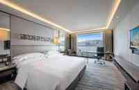

Classic Victoria Harbour View room. Photo: InterContinental Grand Stanford Hong Kong, from the hotel's official website (hongkong.intercontinental.com), shown for trip planning. The brochure PDF also has the bathroom, Premium room and suite photos.

* **Address:** 70 Mody Road, East Tsim Sha Tsui, Kowloon. Tel +852 2721 5161
* **Nearest MTR:** East Tsim Sha Tsui (the hotel says about a 10 minute walk)
* **Why:** Harbourfront in TST East. Woodlands and Sangeetha are 3 to 6 minutes on foot (earlier research), Kowloon Park is close, and the Citybus A21 airport bus stops on Mody Road.
* **Room to request:** Classic Victoria Harbour View, 32 sqm, 1 to 3 persons, with crib or rollaway available, or the Premium harbour view room. Ask for a king with a rollaway bed for your daughter and confirm the third guest when booking.
* **Approx nightly rate:** From HK$1,374 (AwardStays calendar to 28 Oct 2026), HK$1,672 in an earlier listing, about US$229 (about HK$1,797, taxes included) per fermata.travel. A 10% service charge and 3% hotel tax apply to the room rate per the hotel's offers page. Rollaway HK$622 per night (Booking.com listing, unconfirmed).

* [InterContinental Grand Stanford Hong Kong, rooms (official)](https://www.ihg.com/intercontinental/hotels/gb/en/hong-kong/hkghb/hoteldetail/rooms) (ihg.com)
* [Hotel photo: InterContinental Grand Stanford. Photo: Mk2010, CC BY-SA 3.0, via Wikimedia Commons](https://upload.wikimedia.org/wikipedia/commons/thumb/c/c1/InterContinental_Grand_Stanford_Hong_Kong_%28Hong_Kong%29.jpg/960px-InterContinental_Grand_Stanford_Hong_Kong_%28Hong_Kong%29.jpg) (Wikimedia Commons)

### Macau, Jan 15 to 17 (2 nights): Sofitel Macau at Ponte 16

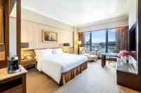

Guest room. Photo: Sofitel Macau at Ponte 16, from the hotel's official room gallery (ponte16.com.mo). The gallery does not name room categories, so this shows room style and is not a guarantee of the Luxury King. The brochure PDF has more room photos.

* **Address:** Rua do Visconde Paco de Arcos, Macau peninsula
* **Nearest MTR:** Macau has no MTR. The Outer Harbour Ferry Terminal is about 3.6 km by road (approx), and Senado Square about 1 km (approx).
* **Why:** Peninsula location near Senado Square, the Ruins and the Red Market, and close to Woodlands Macau (about 3.3 km by road, approx).
* **Room to request:** Luxury Room with 1 King and river view, 37 sqm. Accor lists 22 connecting luxury rooms and 10 family suites if you prefer more space. Children 0 to 11 stay free on existing bedding, and an extra bed is free for ages 3 to 11 (Booking.com listing, unconfirmed).
* **Approx nightly rate:** About EUR 103 for a January average and EUR 137 on a Saturday (Agoda via stayversus.com, checked 21 Oct 2026), or MOP 1,123 in an earlier listing. Service charge and tourism tax are assumed at 15% and not confirmed for this hotel.

* [Sofitel Macau at Ponte 16 (official, Accor)](https://all.accor.com/hotel/6480/index.en.shtml) (all.accor.com)
* [Sofitel Macau at Ponte 16, rooms (official, Accor)](https://sofitel.accor.com/en/hotels/6480/rooms.html) (sofitel.accor.com)
* [Hotel photo: Sofitel Macau at Ponte 16. Photo: lienyuan lee, CC BY 3.0, via Wikimedia Commons](https://upload.wikimedia.org/wikipedia/commons/thumb/1/18/Sofitel_Macau_at_Ponte_16_%E6%BE%B3%E9%96%80%E5%8D%81%E5%85%AD%E6%B5%A6%E7%B4%A2%E8%8F%B2%E7%89%B9%E5%A4%A7%E9%85%92%E5%BA%97_-_panoramio.jpg/960px-Sofitel_Macau_at_Ponte_16_%E6%BE%B3%E9%96%80%E5%8D%81%E5%85%AD%E6%B5%A6%E7%B4%A2%E8%8F%B2%E7%89%B9%E5%A4%A7%E9%85%92%E5%BA%97_-_panoramio.jpg) (Wikimedia Commons)

## Visas for Indian passports

* **Hong Kong:** Free online Pre-arrival Registration for each of you, including your daughter, for up to 14 days. Apply 4 to 6 weeks ahead and carry the printed slip. Passport valid 6+ months.
* **Macau:** Visa-free up to 30 days. Passport valid 90+ days past the stay, return ticket, hotel booking, and proof of MOP 5,000 per person.
* **Money:** HKD in Hong Kong, MOP in Macau. A Tourist Octopus card costs HK$39 and also works on the bridge bus.

## Book or do first

* [x] Cathay flights chosen (as of 29 Oct 2026)
* [ ] Book Cathay flights
* [ ] Hong Kong Pre-arrival Registration for all three
* [ ] Hotels: InterContinental Grand Stanford 9 to 15 Jan, Sofitel Macau at Ponte 16 15 to 17 Jan
* [ ] Dolphinwatch for Sun 10 Jan, booked by email
* [ ] Disneyland tickets and park date for Tue 12 Jan
* [ ] House of Dancing Water for Fri 15 Jan (flash sale listed 28 Oct to 6 Nov 2026)
* [ ] Recheck Ngong Ping 360 maintenance in December

## Budget

For 2 adults and 1 child aged 8. Change the selections to see the totals move. Exchange rates on 29 Oct 2026: USD 1 = INR 95.25, USD 1 = HK$7.8458, so HK$1 = INR 12.14. MOP is treated as pegged at HK$1 = MOP 1.03 (peg, not separately sourced). EUR 1 = HK$8.74 (ECB reference about 8.73). Prices are from the sources listed below and are estimates, not quotes.

* **INR 6,53,276**: Grand total in INR. Flights at INR 95.25 per USD, the rest at INR 12.14 per HK$
* **HK$53,811**: Grand total in HKD
* **USD 1,656**: Flights in USD. HK$12,993 at 7.8458
* **HK$907**: Taxis and local legs in this mode

| Category | Basis | HKD | INR |
| --- | --- | ---: | ---: |
| Flights | USD 1,656 = 3 x USD 552 round trip (Google Flights). Assumes the child fare equals the adult fare. | HK$12,993 | INR 1,57,734 |
| Hotels | Hong Kong 6 nights x HK$1,889 (rate x 1.13 for 10% service charge and 3% hotel tax) + rollaway HK$622 x 6; Macau 2 nights x HK$1,254 (rate x 1.15, assumed) | HK$17,576 | INR 2,13,375 |
| Attractions | Disneyland, Ocean Park, Ngong Ping 360, Peak combo, Dolphinwatch, House of Dancing Water x 3 seats | HK$9,142 | INR 1,10,987 |
| Local transport | Mixed taxi and public transport + TurboJET + HZMB bus + Octopus cards + trams | HK$1,768 | INR 21,460 |
| Food | 6 Hong Kong days at about HK$941 and 3 Macau days at about HK$895 for the family (estimate) | HK$8,333 | INR 1,01,159 |
| Shopping allowance | Adjustable allowance, not a quote | HK$2,000 | INR 24,281 |
| Visas | Hong Kong Pre-arrival Registration is free; Macau is visa-free | HK$0 | INR 0 |
| Misc, SIM, insurance | Adjustable allowance, not a quote | HK$2,000 | INR 24,281 |
| Grand total | All lines above | HK$53,811 | INR 6,53,276 |

| Item | Value |
| --- | --- |
| Hotels | INR 2,13,375 |
| Flights | INR 1,57,734 |
| Attractions | INR 1,10,987 |
| Food | INR 1,01,159 |
| Shopping allowance | INR 24,281 |
| Misc, SIM, insurance | INR 24,281 |
| Local transport | INR 21,460 |

### Budget options

The totals above use the default selections. The options available in the original interactive budget are:

* **Disneyland ticket tier:** Tier 1 (12 Jan is listed here): adult 669, child 499 (default); Tier 2: adult 759, child 569; Tier 3: adult 849, child 639; Tier 4: adult 939, child 705
* **House of Dancing Water seat:** Gallery, MOP 698; Gallery flash sale, MOP 500 (until 6 Nov 2026); Signature, MOP 898; Signature flash sale, MOP 650 (until 6 Nov 2026); Grand, MOP 1,098 (mid tier) (default); Grand flash sale, MOP 800 (until 6 Nov 2026); Premium, MOP 1,298; Golden Circle, MOP 1,598
* **Hotel rate level:** Lower rates (HK$1,374 / Macau EUR 103); Middle rates (HK$1,672 / Macau MOP 1,123) (default); Higher rates (about HK$1,797 taxes included / Macau EUR 137)
* **Food level:** Lean; Mixed (default); Comfortable
* **Shopping allowance:** No shopping budget; HK$2,000 (default); HK$5,000; HK$10,000
* **Misc allowance (SIM, insurance, tips):** HK$1,000; HK$2,000 (default); HK$4,000
* **Add a rollaway bed in Hong Kong (HK$622 per night, unconfirmed):** on (default) or off
* **Local transport mode:** Taxi plus public transport (default); Taxi for everything

### Attractions detail

| Item | Basis | HKD |
| --- | --- | ---: |
| Hong Kong Disneyland | Adult 669 x 2 + child 499 | HK$1,837 |
| Ocean Park | Adult 538 x 2 + child 269 | HK$1,345 |
| Ngong Ping 360 | Adult 295 x 2 + child 150 | HK$740 |
| Peak Tram and Sky Terrace combo | Adult 182 x 2 + child 118 | HK$482 |
| Hong Kong Dolphinwatch | Adult 580 x 2 + child 380 | HK$1,540 |
| House of Dancing Water | MOP 1,098 x 3 seats (one price for all ages assumed) | HK$3,198 |
| Free: Kowloon Park, Zoo and Gardens, Panda Pavilion, Symphony of Lights | No ticket | HK$0 |

Disneyland prices are from travelsmarterasia.com and the official calendar link. House of Dancing Water prices are from City of Dreams, in MOP. Park food is not modelled separately and may cost more than the food estimate.

### Local transport detail

| Item | Basis | HKD |
| --- | --- | ---: |
| Taxis (mixed) | From the Taxi fares table | HK$907 |
| TurboJET Sheung Wan to Macau | About HK$564 for 3, weekday | HK$564 |
| HZMB bus Macau to Hong Kong | HK$65 x 2 + HK$33 | HK$163 |
| Tourist Octopus cards | 3 cards x HK$39 (assumed one per person) | HK$117 |
| Trams | 2 rides: HK$3.30 x 2 + HK$1.60 each | HK$16 |

### Food assumptions

Per person per day, in HKD. Dinner is anchored to Woodlands thali prices (HK$129 South Indian, HK$142 North Indian, HK$183 Special in Hong Kong; MOP 118, 128 and 158 in Macau). Breakfast, lunch and snacks are my estimates with no source. The child is counted as 0.6 of an adult, an assumption. Selected level: Mixed, with breakfast 70, lunch 110, snacks 40.

### Taxi for everything

The same budget with the "Taxi for everything" local transport mode.

* **INR 6,80,452**: Grand total in INR. Flights at INR 95.25 per USD, the rest at INR 12.14 per HK$
* **HK$56,049**: Grand total in HKD
* **USD 1,656**: Flights in USD. HK$12,993 at 7.8458
* **HK$3,146**: Taxis and local legs in this mode

| Category | Basis | HKD | INR |
| --- | --- | ---: | ---: |
| Flights | USD 1,656 = 3 x USD 552 round trip (Google Flights). Assumes the child fare equals the adult fare. | HK$12,993 | INR 1,57,734 |
| Hotels | Hong Kong 6 nights x HK$1,889 (rate x 1.13 for 10% service charge and 3% hotel tax) + rollaway HK$622 x 6; Macau 2 nights x HK$1,254 (rate x 1.15, assumed) | HK$17,576 | INR 2,13,375 |
| Attractions | Disneyland, Ocean Park, Ngong Ping 360, Peak combo, Dolphinwatch, House of Dancing Water x 3 seats | HK$9,142 | INR 1,10,987 |
| Local transport | All by taxi + TurboJET + HZMB bus + Octopus cards + trams | HK$4,006 | INR 48,636 |
| Food | 6 Hong Kong days at about HK$941 and 3 Macau days at about HK$895 for the family (estimate) | HK$8,333 | INR 1,01,159 |
| Shopping allowance | Adjustable allowance, not a quote | HK$2,000 | INR 24,281 |
| Visas | Hong Kong Pre-arrival Registration is free; Macau is visa-free | HK$0 | INR 0 |
| Misc, SIM, insurance | Adjustable allowance, not a quote | HK$2,000 | INR 24,281 |
| Grand total | All lines above | HK$56,049 | INR 6,80,452 |

| Item | Value |
| --- | --- |
| Hotels | INR 2,13,375 |
| Flights | INR 1,57,734 |
| Attractions | INR 1,10,987 |
| Food | INR 1,01,159 |
| Local transport | INR 48,636 |
| Shopping allowance | INR 24,281 |
| Misc, SIM, insurance | INR 24,281 |

#### Local transport detail

| Item | Basis | HKD |
| --- | --- | ---: |
| Taxis (all by taxi) | From the Taxi fares table | HK$3,146 |
| TurboJET Sheung Wan to Macau | About HK$564 for 3, weekday | HK$564 |
| HZMB bus Macau to Hong Kong | HK$65 x 2 + HK$33 | HK$163 |
| Tourist Octopus cards | 3 cards x HK$39 (assumed one per person) | HK$117 |
| Trams | 2 rides: HK$3.30 x 2 + HK$1.60 each | HK$16 |

## Taxi fares

Every transfer in the plan, priced from the official tables. Hong Kong red (urban) taxis: HK$29 for the first 2 km, then HK$2.10 per 200 m until the fare reaches HK$102.50, then HK$1.40 (Transport Department table effective 14 Jul 2024). Lantau blue taxis: HK$24 for the first 2 km, then HK$1.90 until HK$195, then HK$1.60. Luggage is HK$6 per piece. Cross-harbour tunnel toll HK$25 plus a HK$25 return toll passed to passengers, Aberdeen Tunnel HK$8, and the Lantau Link is toll-free to taxis. Macau (DSAT): MOP 21 for the first 1,600 m, then MOP 2 per 220 m, MOP 3 per boot luggage item, MOP 8 boarding surcharge at the airport and some ports (not at the Outer Harbour Ferry Terminal or the hotel), and a Coloane surcharge.

> [!WARNING]
> **Estimates.** Distances are approximate road distances from a routing service in free-flowing traffic, not meter readings. Waiting time, traffic delays and tips are not included. Toll routes and bag counts are assumptions. As a check, the same formula gives about HK$266 for 32.1 km, matching a published HKG to Tsim Sha Tsui fare.

* **HK$3,146**: All by taxi. INR 38,190
* **HK$907**: Mixed: taxi for luggage legs, public transport or walking otherwise. INR 11,015

| Leg | Approx km | Meter fare | Tolls, bags, extras | Taxi total | Cheaper alternative | Alternative for 3 |
| --- | ---: | ---: | --- | ---: | --- | ---: |
| Jan 9: HKG airport to hotel | 34.6 | HK$281.7 | 3 bags assumed | HK$300 | Citybus A21 to Mody Road stop: 34.60 x 2 adults + 17.30 child (child fare unverified), about 84 min | HK$86.50 |
| Jan 9: Hotel to Kowloon Park | 2.0 | HK$29.0 | none | HK$29 | Walk | HK$0 |
| Jan 9: Kowloon Park to Yuen Po Bird Garden, Mong Kok | 4.6 | HK$56.3 | none | HK$56 | MTR to Prince Edward: 5.90 x 2 + 3.20 | HK$15.00 |
| Jan 9: Ladies' Market to hotel | 3.0 | HK$39.5 | none | HK$40 | MTR Mong Kok to East TST: 5.90 x 2 + 3.20 | HK$15.00 |
| Jan 10: Hotel to Dolphinwatch pickup (Kowloon Hotel, TST; distance uses Kowloon Park as a proxy) | 2.0 | HK$29.0 | none | HK$29 | Walk | HK$0 |
| Jan 10: Dolphinwatch pickup back to hotel (same proxy distance) | 2.0 | HK$29.0 | none | HK$29 | Walk | HK$0 |
| Jan 10: Hotel to Harbour City | 2.5 | HK$35.3 | none | HK$35 | Walk | HK$0 |
| Jan 10: Harbour City to hotel | 2.5 | HK$35.3 | none | HK$35 | Walk | HK$0 |
| Jan 11: Hotel to Tung Chung (Ngong Ping 360, Citygate) | 32.5 | HK$267.7 | Lantau Link toll-free to taxis | HK$268 | MTR to Tung Chung: 18.70 x 2 + 9.40 | HK$46.80 |
| Jan 11: Tung Chung to hotel | 32.5 | HK$267.7 | Lantau Link toll-free to taxis | HK$268 | MTR from Tung Chung: 18.70 x 2 + 9.40 | HK$46.80 |
| Jan 12: Hotel to Hong Kong Disneyland | 23.6 | HK$204.7 | none | HK$205 | MTR to Disneyland Resort: 22.20 x 2 + 11.10 | HK$55.50 |
| Jan 12: Disneyland to hotel | 23.6 | HK$204.7 | none | HK$205 | MTR from Disneyland Resort: 22.20 x 2 + 11.10 | HK$55.50 |
| Jan 13: Hotel to Ocean Park | 9.1 | HK$103.9 | Harbour tunnel 25 + return toll 25 + Aberdeen Tunnel 8 (route assumed) | HK$162 | MTR to Ocean Park: 13.20 x 2 + 6.50 | HK$32.90 |
| Jan 13: Ocean Park to hotel | 9.1 | HK$103.9 | Harbour tunnel 25 + return toll 25 + Aberdeen Tunnel 8 (route assumed) | HK$162 | MTR from Ocean Park: 13.20 x 2 + 6.50 | HK$32.90 |
| Jan 14: Hotel to Zoological and Botanical Gardens, Central | 7.0 | HK$81.5 | Harbour tunnel 25 + return toll 25 | HK$132 | MTR to Central, then a short uphill walk: 10.60 x 2 + 5.40 | HK$26.60 |
| Jan 14: Peak Tram area to hotel | 6.6 | HK$77.3 | Harbour tunnel 25 + return toll 25 | HK$127 | Tram/bus to Central, then MTR: 10.60 x 2 + 5.40 | HK$26.60 |
| Jan 14: Hotel to Temple Street | 3.2 | HK$41.6 | none | HK$42 | MTR to Jordan: 4.90 x 2 + 3.20 | HK$13.00 |
| Jan 14: Temple Street to hotel | 3.2 | HK$41.6 | none | HK$42 | MTR from Jordan: 4.90 x 2 + 3.20 | HK$13.00 |
| Jan 15: Hotel to Sheung Wan ferry terminal | 7.2 | HK$83.6 | Harbour tunnel 25 + return toll 25; 3 bags assumed | HK$152 | MTR to Sheung Wan with luggage: 10.60 x 2 + 5.40 | HK$26.60 |
| Jan 15: Macau Outer Harbour ferry terminal to Sofitel | 3.6 | MOP 41 | 3 bags MOP 3 each; no ferry-terminal surcharge | MOP 50 (HK$49) | Macau bus MOP 6 each, 3 riders (route unverified) | MOP 18 (HK$17) |
| Jan 15: Sofitel to City of Dreams | 8.9 | MOP 89 | none | MOP 89 (HK$86) | Macau bus MOP 6 each, 3 riders (route unverified) | MOP 18 (HK$17) |
| Jan 15: City of Dreams to Sofitel | 8.9 | MOP 89 | none | MOP 89 (HK$86) | Macau bus MOP 6 each, 3 riders (route unverified) | MOP 18 (HK$17) |
| Jan 15: Sofitel to Ruins of St Paul's | 1.6 | MOP 21 | none | MOP 21 (HK$20) | Walk | HK$0 |
| Jan 15: Ruins of St Paul's to Sofitel | 1.6 | MOP 21 | none | MOP 21 (HK$20) | Walk | HK$0 |
| Jan 16: Sofitel to Giant Panda Pavilion, Coloane | 10.3 | MOP 101 | Macau to Coloane surcharge MOP 5 | MOP 106 (HK$103) | Macau bus MOP 6 each, 3 riders (route unverified) | MOP 18 (HK$17) |
| Jan 16: Panda Pavilion to Taipa Village | 6.4 | MOP 65 | Coloane/Taipa surcharge MOP 2 (direction assumed) | MOP 67 (HK$65) | Macau bus MOP 6 each, 3 riders (route unverified) | MOP 18 (HK$17) |
| Jan 16: Taipa Village to Sofitel | 7.7 | MOP 77 | none | MOP 77 (HK$75) | Macau bus MOP 6 each, 3 riders (route unverified) | MOP 18 (HK$17) |
| Jan 16: Sofitel to Woodlands Macau | 3.3 | MOP 37 | none | MOP 37 (HK$36) | Macau bus MOP 6 each, 3 riders (route unverified) | MOP 18 (HK$17) |
| Jan 16: Woodlands Macau to Sofitel | 3.0 | MOP 35 | none | MOP 35 (HK$34) | Macau bus MOP 6 each, 3 riders (route unverified) | MOP 18 (HK$17) |
| Jan 17: Sofitel to Senado Square / Red Market | 0.9 | MOP 21 | none | MOP 21 (HK$20) | Walk | HK$0 |
| Jan 17: Senado Square / Red Market to Sofitel | 0.9 | MOP 21 | none | MOP 21 (HK$20) | Walk | HK$0 |
| Jan 17: Sofitel to HZMB Macau port | 8.3 | MOP 83 | 3 bags MOP 3 each; no boarding surcharge at the hotel | MOP 92 (HK$89) | Macau bus MOP 6 each, 3 riders (route unverified), then the HZMB bus HK$65 adult, HK$33 child | MOP 18 (HK$17) |
| Jan 17: HZMB Hong Kong port to HKG airport | 10.8 | HK$107.6 | Lantau (blue) table; 3 bags assumed | HK$126 | NLB B4 bus HK$9.80 x 3 (child fare unverified, adult fare used) | HK$29.40 |

Arriving by Airport Express costs HK$105 per adult and HK$52.50 for the child, about HK$262.50 for three, and you still need a short taxi to the hotel, so for three people with bags the A21 bus or a taxi is cheaper. The A21 child fare and the B4 child fare are unverified, and Macau bus routes are unverified.

## Sources

* [InterContinental Grand Stanford rooms](https://www.ihg.com/intercontinental/hotels/gb/en/hong-kong/hkghb/hoteldetail/rooms) (ihg.com)
* [InterContinental Hong Kong offers (service charge and tax)](https://www.hongkong.intercontinental.com/offers/) (hongkong.intercontinental.com)
* [InterContinental room: Classic Victoria Harbour View](https://www.hongkong.intercontinental.com/accommodation/premier-full-harbour-view-room/) (hongkong.intercontinental.com)
* [InterContinental Grand Stanford rate calendar](https://awardstays.com/hotels/ihg-hong-kong-hkghb/) (awardstays.com)
* [Sofitel Macau at Ponte 16](https://all.accor.com/hotel/6480/index.en.shtml) (accor.com)
* [Sofitel Macau rooms](https://sofitel.accor.com/en/hotels/6480/rooms.html) (accor.com)
* [Sofitel Macau price comparison](https://stayversus.com/en/hotel/sofitel-macau-at-ponte-16-hotel-macau/prices/) (stayversus.com)
* [Sofitel Macau child policy (unconfirmed)](https://www.booking.com/hotel/mo/macau-at-ponte-16.html) (booking.com)
* [Hong Kong Dolphinwatch booking](http://www.hkdolphinwatch.com/booking_a.php) (hkdolphinwatch.com)
* [Hong Kong Pre-arrival Registration for Indian nationals](https://www.immd.gov.hk/eng/services/visas/pre-arrival_registration_for_indian_nationals.html) (immd.gov.hk)
* [Macau entry conditions](https://www.gov.mo/en/services/ps-1474/ps-1474b/) (gov.mo)
* [Ocean Park animal experiences](https://www.oceanpark.com.hk/en/a-day-at-the-park/get-closer-to-the-animals) (oceanpark.com.hk)
* [Disneyland tickets](https://estore.mtr.com.hk/categories/tourist-ticket) (estore.mtr.com.hk)
* [Disneyland ticket tiers](https://travelsmarterasia.com/guides/hong-kong-disneyland-tickets/) (travelsmarterasia.com)
* [Disneyland date calendar](https://www.hongkongdisneyland.com/new-day-calendar/iframe/index.html?lang=en) (hongkongdisneyland.com)
* [House of Dancing Water](https://cityofdreamsmacau.com/en/house-of-dancing-water) (cityofdreamsmacau.com)
* [Macau Giant Panda Pavilion](https://www.macaotourism.gov.mo/en/events/whatson/13928/) (macaotourism.gov.mo)
* [Woodlands Hong Kong menu](https://woodlandshk.com/tsim-sha-tsui/menu) (woodlandshk.com)
* [Woodlands Macau menu](https://woodlandsmacauindianvegetarianrestaurant.restaurants-info.com/menu) (restaurants-info.com)
* [Hong Kong taxi fares](https://www.td.gov.hk/en/transport_in_hong_kong/public_transport/taxi/taxi_fare_of_hong_kong/index.html) (td.gov.hk)
* [Taxi fare table (PDF)](https://www.td.gov.hk/filemanager/en/content_276/TaxiFareTable20260510.pdf) (td.gov.hk)
* [Tunnel and bridge toll rates](https://www.td.gov.hk/en/transport_in_hong_kong/tunnels_and_bridges_n/toll_matters/toll_rates_of_road_tunnels_and_lantau_link/) (td.gov.hk)
* [Lantau Link taxi toll exemption](https://www.legco.gov.hk/yr20-21/english/subleg/brief/2020ln224_227_brf.pdf) (legco.gov.hk)
* [Sample HKG to Tsim Sha Tsui taxi fare](https://hkutilitymap.com/en/taxi-fare/tsim-sha-tsui) (hkutilitymap.com)
* [Macau taxi fares](https://www.dsat.gov.mo/dsat/subpage.aspx?a_id=1610600672) (dsat.gov.mo)
* [Macau taxis](https://www.macaotourism.gov.mo/en/travelessential/before-you-travel/local-transportation?tab=taxis) (macaotourism.gov.mo)
* [Macau taxi rules, Despacho 23/2024](https://images.bo.dsaj.gov.mo/bo/i/2024/06/despce-23-2024.pdf) (images.bo.dsaj.gov.mo)
* [Macau bus fares](https://www.dsat.gov.mo/dsat/subpage.aspx?a_id=1612338099) (dsat.gov.mo)
* [MTR fares open data](https://opendata.mtr.com.hk/data/mtr_lines_fares.csv) (opendata.mtr.com.hk)
* [Citybus A21 route and fare](https://kongride.hk) (kongride.hk)
* [NLB B4 route](https://www.nlb.com.hk/route/detail/87) (nlb.com.hk)
* [Hong Kong Tramways fares](https://www.hktramways.com/en/schedules-fares) (hktramways.com)
* [USD to INR rate](https://exa.ai/library/markets/forex/USDINR) (exa.ai)
* [USD to HKD rate](https://exa.ai/library/markets/forex/USDHKD) (exa.ai)
* [EUR to HKD rate](https://exa.ai/library/markets/forex/EURHKD) (exa.ai)
* [Hong Kong Tourism Board attractions](https://www.discoverhongkong.com/eng/attractions.html) (discoverhongkong.com)
* [Macao Government Tourism Office](https://www.macaotourism.gov.mo/en/) (macaotourism.gov.mo)
* [Hong Kong Science Museum](https://hk.science.museum/en/web/scm/index.html) (hk.science.museum)
* [Hong Kong Palace Museum tickets](https://www.hkpm.org.hk/en/visit/ticket) (hkpm.org.hk)
* [M+ admission](https://www.mplus.org.hk/en/admission-tickets/) (mplus.org.hk)
* [Star Ferry fares](https://www.starferry.com.hk/en/service) (starferry.com.hk)
* [Noah's Ark tickets](https://www.noahsark.com.hk/eng/noahs-ark-tickets.jsp) (noahsark.com.hk)
* [Aqua Luna Symphony of Lights cruise](https://aqualuna.com.hk/experiences/symphony-of-lights-cruise-%e5%b9%bb%e5%bd%a9%e8%a9%a0%e9%a6%99%e6%b1%9f%e9%81%8a%e8%88%b9/) (aqualuna.com.hk)
* [Macau Tower observation deck](https://www.macautower.com.mo/en/observation-deck/) (macautower.com.mo)
* [Macao Science Center tickets](https://www.msc.org.mo/en/article-detail/11/ticketing) (msc.org.mo)
* [teamLab SuperNature Macao](https://www.cotaiticketing.com/shows/teamlab.html) (cotaiticketing.com)
* [teamLab SuperNature Macao, official](https://www.teamlab.art/e/macao/) (teamlab.art)
* [teamLab 2026 schedule](https://assets.sandsresortsmacao.cn/cotaiticketing/teamLab/teamLab_schedule_public.pdf) (assets.sandsresortsmacao.cn)
* [Hong Kong Space Museum, visit and facilities](https://hk.space.museum/en/web/spm/visit-and-facilities.html) (hk.space.museum)
* [Hong Kong Space Museum, shows](https://hk.space.museum/en/web/spm/shows.html) (hk.space.museum)
* [Hong Kong Science Museum, opening hours](https://hk.science.museum/en/web/scm/visit/opening-hours.html) (hk.science.museum)
* [InterContinental Grand Stanford, room pages](https://www.hongkong.intercontinental.com/accommodation/premier-full-harbour-view-room/) (hongkong.intercontinental.com)
* [Sofitel Macau at Ponte 16, room gallery](https://www.ponte16.com.mo/en/hotel/room) (ponte16.com.mo)
* [Studio City Water Park](https://studiocity-macau.com/en/attractions/studio-city-water-park) (studiocity-macau.com)
* [Venetian gondola rides](https://venetianmacao.com/hotel/amenities/gondola-rides.html) (venetianmacao.com)

Also published as a web page: <https://hong-kong-and-macau-family-trip-jan-2027-asf7.pages.grok.bot/>
